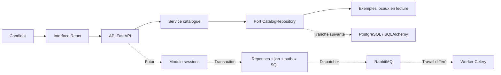

# ADR-001 — Application neuve et première tranche candidat

Décision technique de démarrage, 21 novembre 2026. Public confirmé par le porteur : premier emploi ou stage, Burkina Faso. Mise à jour du 22 novembre : **OUOBA Abdou Rasmané** porte produit, relecture métier et coordination ; les avis restent à recevoir.

La proposition [S0-0.4](../sprints/S0-cloture/07_ENTRETIEN_ADAPTATIF_ET_MULTI_IA.md) précise désormais un entretien adaptatif et une frontière `ai_gateway` à ports distincts par capacité. Politique et critères figés au démarrage ; questions créées à partir du précédent couple question/réponse confirmée, puis figées par tour. Jobs/outbox nécessaires dès la génération en S3. [Impacts et capacité](../sprints/S0-cloture/08_IMPACTS_ET_CAPACITE.md) : 24 h par personne, 120 h par sprint. Aucun composant privé ou fournisseur IA n’est implémenté par cette mise à jour de conception ; la réception de S0 précède toute poursuite des sprints.

## Décision

Le code est écrit dans `application/`, sans réutilisation du code de `projet-source/`. Les études et maquettes existantes servent de références. React/TypeScript assure l’interface ; Python 3.12 et FastAPI/Pydantic assurent l’API. Les dépendances effectivement essayées sont verrouillées avec cette tranche.

Le premier backend est un monolithe modulaire. Le catalogue possède ses schémas, son service et son port de dépôt. Une implémentation PostgreSQL remplacera le dépôt d’exemples sans faire dépendre les autres domaines des tables du catalogue. L’extraction en microservices dépendra de besoins mesurés de charge, d’isolation ou de déploiement indépendant.

La tranche locale couvre découverte, catalogue et préparation. Les exemples JSON sont intégrés au paquet Python, strictement en lecture. `APP_ENV` n’accepte que `local` ou `test` : cette application refuse actuellement de démarrer en production. `visibility=published` signifie visible dans la démonstration ; `content_status=example_pending_review` signale que la relecture métier reste ouverte.

## Frontières et responsabilités futures

| Module | Données possédées | Place dans le démarrage |
|---|---|---|
| catalog | Scénarios, versions, questions, grilles | Implémenté pour exemples locaux ; port de dépôt substituable |
| identity | Utilisateur interne, issuer/subject, accès, préférences | Contrat à préparer ; aucun faux compte actif |
| sessions | Sessions, questions figées, réponses, révisions | Contrat proposé ; aucune réponse recueillie |
| evaluation | Demande, résultat, preuves et provenance | Spécification ; aucun score ni appel fournisseur |
| processing | Jobs, outbox, tentatives et rapprochement | Architecture retenue ; aucun worker lancé |
| ai_gateway | Registre/configuration des fournisseurs, ports par capacité et adaptateurs | Contrat S0-0.4 proposé ; aucun fournisseur qualifié ou appelé |
| privacy | Export/suppression et suivi d’exécution | Spécification ; politique à faire valider |
| reports | Lecture des retours autorisés et rapport | À implémenter après conservation des réponses |
| media / realtime | Prises privées, transcription, dialogue et tours confirmés | Lots audio/vidéo ultérieurs |

Les modules utilisent des services/ports explicites, sans lecture des tables privées d’un autre module. PostgreSQL et SQLAlchemy/Alembic restent les choix pour la persistance. Celery/RabbitMQ avec outbox restent les choix pour les travaux différés. Ces composants ne sont pas encore qualifiés par cette tranche et ne doivent pas être annoncés comme opérationnels.

## Compromis et suites

Cette étape rend le parcours observable avant de collecter des données privées. Elle ne démontre ni capacité nationale, ni fiabilité de sauvegarde, ni qualité d’une évaluation IA. La prochaine étape de S1 prépare migrations depuis une base vide, publication versionnée, environnement de test, CI et contrôles de restauration. Les comptes réels et les réponses persistées suivent les critères des sprints S2/S3. L’audio et la vidéo ont leur propre recette et ne sont pas des options activées par cet écran.
