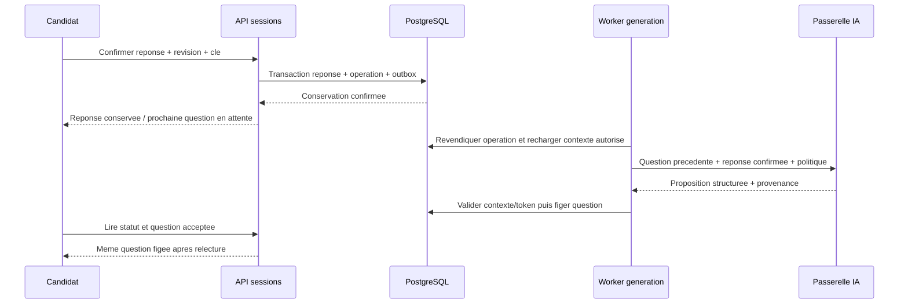
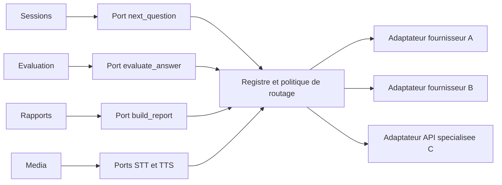

# S0-0.4 — Entretien adaptatif et plusieurs fournisseurs IA

22 novembre 2026. **Exigences reçues du porteur : la question suivante dépend de la question précédente et de sa réponse ; plusieurs API ou IA peuvent servir l’ensemble du projet.** La disponibilité est confirmée à 24 heures par développeur et par sprint de deux semaines. Cette version remplace, pour ces points, le plan fixe de S0-0.3. Elle reste à relire ; aucune nouvelle fonction de production n’est déployée.

**Précision fournisseur/API :** [l’addendum API-0.1](09_FOURNISSEURS_IA_ET_UTILISATION_API.md) présente les candidats OpenAI/Mistral/Anthropic/Gemini, la variante routeur, un exemple Python et les conditions avant activation. `ai-registry.example.json` reste un schéma fictif A/B/C ; `ai-routing.proposal.json` nomme des candidats réels, tous désactivés et non qualifiés. Les noms ne constituent pas une décision approuvée.

## 1. Entretien adaptatif, avec un cadre pédagogique stable

La première question vient d’un scénario relu. Après chaque réponse confirmée, le serveur prépare la prochaine question à partir de **la question effectivement posée et de sa réponse figée**, de l’objectif, des axes déjà couverts et du contexte utile de la session. Une relance peut demander une précision ; une transition peut aborder un autre axe en tenant compte de ce qui vient d’être dit.

Exemple fictif : question « Quel stage recherchez-vous ? », réponse « Je souhaite apprendre la comptabilité, j’ai aidé à tenir un cahier de ventes ». La question suivante peut demander le rôle exact dans cette activité avant d’aborder les vérifications. Avec « Je n’ai encore aucune activité à citer », la relance doit proposer un apprentissage ou une démarche accessible, sans inventer un emploi passé.

Le corpus de quinze questions devient une **banque de départ et de référence**, répartie en trois scénarios et cinq axes par scénario. Il ne promet plus une liste identique de cinq questions pour tous les candidats. Proposition de limites à relire : cinq axes, jusqu’à sept questions au total, au plus deux relances de clarification. Ces limites bornent durée et coût ; elles ne notent pas le candidat.

Les axes, critères, limites, règles de relance et paramètres de génération sont versionnés et figés à la création de session. Les questions suivantes sont créées progressivement, puis **immuables une fois acceptées et présentées**. Reconnexion, actualisation, réessai et changement de fournisseur ne reformulent pas une question déjà posée.

## 2. Données possédées et provenance

| Ressource | Données nécessaires |
|---|---|
| `InterviewPolicySnapshot` | Scénario/version, banque/version, grille, objectifs/axes, limites, règles de terminaison, version de prompt et politique de routage |
| `QuestionInstance` | ID, index réel, texte accepté, axe, type première/relance/transition, version, état et date de présentation |
| `Answer` | ID, `question_instance_id`, texte confirmé, révision, propriétaire et date de conservation |
| `NextQuestionOperation` | Opération unique, précédente question, ID/révision/empreinte de réponse, contexte référencé, politique, état et jeton courant |
| `ProviderAttempt` | Opération, capacité, fournisseur/configuration/modèle, version de prompt, début/fin, catégorie d’erreur, usage et coût mesuré |

Une trace de génération porte au minimum `previous_question_id`, `previous_answer_id`, `previous_answer_revision` et `policy_version`. La réponse d’un autre candidat n’entre jamais dans ce contexte. L’historique utile est borné ; toute synthèse de contexte a sa propre version et conserve les liens aux tours sources.

La question posée et ses critères autorisés appartiennent à `sessions`. Le module IA fournit une proposition structurée ; il ne modifie pas directement l’état de session ni ses réponses. Les textes de question qui reprennent une réponse privée sont couverts par export, suppression et autorisation.

## 3. Séparer les trois confirmations

1. **Réponse conservée** : transaction durable, indépendante de la réussite d’une IA.
2. **Question suivante prête** : génération/règle contextualisée validée, question figée et autorisée.
3. **Retour pédagogique prêt** : évaluation validée avec preuve et provenance.

La génération suivante et l’évaluation peuvent avancer séparément. L’entretien ne doit pas attendre une note ou une analyse complète pour poser la prochaine question si le contexte nécessaire est déjà confirmé. L’écran distingue « Retour en préparation » de « Question suivante en préparation ».

## 4. Contrats de session modifiés

Le catalogue annonce `interview_mode=adaptive`, `main_axis_count`, `max_question_count` et une durée indicative. Il peut exposer la première question et les exemples de la banque, clairement identifiés comme références. `question_count=5` de l’ancienne fixture ne décrit pas le nombre réel de tours d’un entretien adaptatif.

`POST /api/v1/sessions` fige la politique, crée la première `QuestionInstance` et retourne session/révision/question courante. `GET /api/v1/sessions/{id}` retourne questions réellement acceptées, réponses confirmées, axe courant, couverture et états distincts d’évaluation et de prochaine question ; une lecture ne déclenche pas de génération.

`POST /api/v1/sessions/{id}/answers` reçoit `{question_instance_id, text, expected_session_revision}`, avec clé idempotente. La transaction confirme la réponse, crée l’opération suivante et son outbox si nécessaire. Réponse **201/200** avec `answer_id`, `answer_revision`, `session_revision`, `next_question_operation_id`, `next_question_state`, `evaluation_state` et référence de lecture autorisée. Aucun texte client ne fixe le propriétaire, le fournisseur ou les critères.

`GET /api/v1/sessions/{id}/next-question` lit `{operation_id, state, anchor_answer_id, input_revision, question?, retry_allowed, reason?}`. États : `not_requested`, `queued`, `processing`, `ready`, `unavailable`, `cancelled`, `not_needed`. `ready` exige une question acceptée, pas une chaîne JSON brute du fournisseur.

`POST /api/v1/sessions/{id}/next-question/retry` reçoit `{operation_id, expected_input_revision}`, avec clé. **202** nouveau traitement autorisé / **200** opération déjà connue. Budget, droits et contexte sont recontrôlés. Une opération déjà prête retourne la question existante ; elle n’en génère pas une autre.

Progression : nombre de réponses confirmées, axe courant/couverture, limite totale. Éviter « question 2 sur 5 » quand le nombre final varie. Fin : raison `goals_covered`, `limit_reached` ou `user_stop`, questions réellement posées et couverture. Un arrêt explicite peut laisser une couverture partielle ; le rapport l’annonce. Aucune fin décidée silencieusement par le fournisseur. Une réponse encore locale doit être confirmée ou explicitement abandonnée avant la fin.

## 5. Validations de la proposition de question

Proposition structurée bornée : `{prompt, axis_key, kind, response_kind, criterion_keys, anchor_question_id, anchor_answer_id, rationale_code}`. Prompt proposé maximum 700 caractères, axes/critères issus de la politique, un seul prochain tour par opération. La justification est un code de règle, pas une chaîne de raisonnement interne affichée au candidat.

Refuser : IDs d’ancrage faux, critère inconnu, question répétée sans raison autorisée, fait inventé sur le candidat, demande de données sensibles non nécessaires, consigne de recrutement/discrimination, dépassement de limite. Les réponses du candidat sont des données non fiables pour les instructions de génération : elles ne modifient ni règles système, ni accès outils, ni choix fournisseur. Le serveur valide les contraintes ; une validation de format seule ne démontre pas la pertinence pédagogique.

Question acceptée sous contexte/révision/jeton courants seulement. Une suppression ou révocation invalide l’entrée. Une autre réponse, un résumé de contexte ou une tentative tardive ne doit pas remplacer la question exposée. Contraintes métier et idempotence : une opération canonique par session/réponse d’ancrage/politique, une question suivante acceptée, tentatives distinctes pour usage et erreurs.

## 6. Panne et reprise

En cas de panne de génération, conserver la réponse et annoncer que la question suivante manque. Permettre pause/reconnexion et réessai autorisé. Ne pas afficher une question générique inventée comme si une IA avait réussi.

Deux mécanismes de secours possibles : autre fournisseur **déjà autorisé** pour les mêmes données/capacité, ou règle de relance issue d’une banque **relue et conditionnée par le contexte**. Une simple liste fixe qui ignore la précédente réponse ne satisfait pas l’exigence. Si aucun secours valable n’existe, l’état reste indisponible ; un arrêt volontaire produit un rapport explicitement partiel.

Proposition de borne initiale : au plus deux tentatives fournisseur par opération, tous fournisseurs confondus, sous budget et délai globaux configurés. À qualifier avant activation ; un timeout laisse incertain l’effet externe. Ne pas multiplier les tentatives cachées de chaque SDK. Le compte d’usage candidat ne double pas lors d’un réessai ; le coût de chaque tentative fournisseur reste mesuré.

## 7. Plusieurs API/IA à l’échelle du projet

Créer une frontière `ai_gateway` avec un **registre de fournisseurs et des ports par capacité**, utilisés par les modules métier. Plusieurs fournisseurs peuvent coexister ; il n’est pas nécessaire d’envoyer chaque réponse à tous les fournisseurs.

| Capacité interne | Consommateur | Forme normalisée |
|---|---|---|
| `next_question` | sessions | Contexte autorisé → proposition de question structurée |
| `evaluate_answer` | evaluation | Question/réponse/grille figées → critères/preuves/limites |
| `build_report` | reports | Tours et évaluations référencés → synthèse avec couverture |
| `transcribe_audio` | media, lot audio | Prise privée autorisée → transcription versionnée et limites |
| `synthesize_speech` | media/realtime, lots médias | Texte accepté → voix et métadonnées de lecture |
| `realtime_dialogue` | realtime | Session éphémère, tours confirmés, interruption et arrêt |
| Extraction de documents / traduction | Futures extensions approuvées | Contrats dédiés, sans activation automatique dans le candidat initial |

Les ports ont des DTO métier propres. Un fournisseur peut assurer plusieurs capacités ; une capacité peut être offerte par plusieurs fournisseurs. Un fournisseur uniquement STT ne devient pas un LLM par un payload universel. Les flux temps réel ont leur transport et gestion d’interruption propres ; RabbitMQ ne transporte pas le flux audio interactif ni les médias bruts.

Configuration fournisseur : identifiant, capacités qualifiées, endpoint côté serveur, secret référencé, modèles/versions autorisés, règles de données, timeout, plafond d’usage, catégories d’erreur et état de disponibilité. Aucun secret ou endpoint arbitraire fourni par un candidat. L’API personnalisée d’un prestataire peut être ajoutée par un adaptateur relu, sans modifier tous les modules.

Routage : capacité et exigences → fournisseurs autorisés pour ces données → compatibilité structurée → budget/délai → préférence et disponibilité. Un repli n’est permis que dans cette liste. Les options de résidence et sous-traitance ne sont pas contournées pour gagner en disponibilité. Tracer fournisseur retenu, modèle/configuration, prompt, versions d’entrée, usage et raison de repli. Les traces opérationnelles restent sans réponse brute ni secret.

En S0, aucun fournisseur réel, compte payant, token ou modèle n’est choisi/branché. Les qualifications futures comparent pertinence des questions, français local, JSON valide, preuve, latence, coût, interruption et politiques de données. Le changement de modèle ou d’API impose une qualification des capacités concernées ; pas de note automatiquement comparable entre deux fournisseurs.

## 8. Répartition et preuve de réception

D1 Ouoba : droits sur contexte, reprise, données et règles fournisseur autorisées. D2 Abdou : politique, tours figés, opérations et limites de session. D3 Rasmané : ports IA, validations, erreurs et provenance. D4 limata : attente/question indisponible, progression variable, tests de compréhension. D5 Oumou : registre/configuration, secrets, outbox, tentatives, coûts et exploitation.

La maquette S0-0.4 utilise **des règles locales explicites**, sans IA réelle. Elle sert à observer que deux réponses différentes entraînent des relances différentes, que la précédente question est utilisée et qu’une panne ne perd pas la réponse. L’acceptation réelle d’un fournisseur et la pertinence des relances resteront à qualifier lors de l’implémentation ; la maquette ne les prouve pas.

Dans cette démonstration, une réponse brève déclenche une relance tant que la limite de deux n’est pas atteinte ; cette règle sert à rendre les branches observables. La longueur ne prouve ni compétence, ni manque de clarté, et ne sera pas un critère autonome de choix pédagogique dans le produit. La règle locale consulte le thème de la question précédente et cite un extrait borné de réponse ; le contexte complet du tour précédent reste consultable séparément pour éviter des citations imbriquées sur mobile. La pertinence métier doit être évaluée sur des exemples variés. Les références audio/vidéo conservent une navigation préécrite destinée aux écrans de capture et de relecture ; une notice explicite la distingue du futur déroulement adaptatif à partir des transcriptions confirmées.
