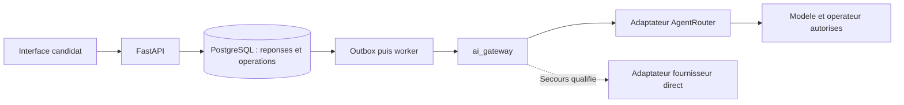

# AgentRouter comme première API de SimuEmploi

**Étude S0, 22 novembre 2026.** Cette fiche répond à la question du porteur concernant <https://agentrouter.org/>. Statut : **candidat à qualifier pour une première intégration texte**. La question de faisabilité ne vaut pas sélection définitive ni autorisation de transmettre des réponses de candidats. Aucune clé, intégration ou requête IA réelle n’a été utilisée. La référence de conception S0-0.4 est approuvée dans ce chat ; la réception finale attend les essais et confirmations restants.

**Suite reçue dans ce chat :** le porteur confirme AgentRouter comme premier candidat à qualifier pour le texte. Cette orientation est enregistrée dans le registre de proposition et les preuves humaines ; qualification, modèle, offre, budget et politique de données restent ouverts.

## Avis proposé

AgentRouter peut être étudié en premier pour un prototype texte. Son rôle de routeur permet d’envisager plusieurs modèles derrière une intégration. Son utilisation dans le backend Python reste conditionnée à l’offre applicable au compte, à un accès API général autorisé et à la qualification du couple modèle / route effective. Les sources publiques consultées ne suffisent pas à le déclarer prêt comme unique dépendance d’un déploiement national puis AES.

L’architecture existante de conception convient : FastAPI, PostgreSQL et le module interne `ai_gateway` restent responsables du parcours. Ajouter ultérieurement un adaptateur AgentRouter permet de remplacer l’intermédiaire sans réécrire les entretiens. Aucun microservice supplémentaire n’est nécessaire pour ce choix.

## Éléments vérifiés dans les sources primaires

| Élément | Constat au 22 novembre | Conséquence pour le projet |
|---|---|---|
| Offre publique | La documentation française présente une plateforme gratuite pour l’IA Coding et cite Claude Code, Codex et Gemini CLI | Confirmer que le compte envisagé autorise une application métier destinée à des candidats |
| Protocole du domaine principal | Le guide Codex documente la base `https://agentrouter.org/v1` avec le protocole Chat Completions | Compatibilité annoncée ; aucun appel Python SimuEmploi testé |
| Offre entreprise | Le portail `co.agentrouter.org` décrit un service de routage compatible avec les formats SDK OpenAI et Anthropic | Vérifier offre, domaine, contrat et droits du compte ; ne pas mélanger les bases des deux offres |
| Modèles | Le guide entreprise indique que les modèles accessibles dépendent du pool associé à la clé ; les conditions ne garantissent pas la présence permanente d’un modèle | Fixer et qualifier un identifiant accessible au compte ; prévoir la disparition d’une route |
| Coûts | Les conditions renvoient aux tarifs de l’offre et prévoient un refus des appels lorsque les crédits sont épuisés | Aucun coût par entretien ni quota gratuit durable n’est confirmé pour SimuEmploi |
| Données | La politique du portail annonce une conservation par défaut des journaux API de 90 jours et un traitement pouvant passer par la Chine continentale et d’autres pays | Distinguer durée des journaux et durée des contenus ; établir la politique applicable avant tout contenu réel |
| Fournisseurs amont | Les textes du portail annoncent que les entrées sont transmises au fournisseur et renvoient aussi à ses propres règles | La déclaration de non-utilisation pour l’entraînement par AgentRouter ne prouve pas une absence de conservation ou de traitement chez chaque opérateur |

Les textes du portail se déclarent applicables à agentrouter.org ; les dispositions réellement attachées au compte public ou entreprise envisagé doivent toutefois être confirmées. Le lecteur Web a rencontré une protection WAF sur la page d’accueil principale : ce constat ne prouve pas un blocage de l’API Python, ni son bon fonctionnement.

Sources :

- [Présentation publique française](https://github.com/agentrouter-org/docs/blob/main/fr/index.md)
- [Configuration publique du protocole Chat Completions](https://github.com/agentrouter-org/docs/blob/main/fr/codex.md)
- [Guide du portail entreprise](https://co.agentrouter.org/portal/guide)
- [Conditions du portail entreprise](https://co.agentrouter.org/portal/terms)
- [Politique de confidentialité du portail entreprise](https://co.agentrouter.org/portal/privacy)

## Périmètre possible de la première intégration

| Capacité SimuEmploi | Proposition | Qualification nécessaire |
|---|---|---|
| `next_question` | Premier cas à évaluer : relance fondée sur la question précédente et la réponse confirmée | Qualité en français, respect des axes et limites, résultat structuré exploitable |
| `evaluate_answer` | Évaluer ensuite sur un corpus fictif commun | Conseils justifiés par la réponse, sans invention ni jugement discriminatoire |
| `build_report` | Évaluer après la cohérence des tours d’entretien | Synthèse traçable, aucun résultat présenté comme décision de recrutement |
| `transcribe_audio`, `synthesize_speech` | Fournisseurs et routes à étudier séparément | Aucun support retenu sur la seule base de la compatibilité texte |
| Vidéo et dialogue temps réel | Extensions ultérieures du parcours | Capture, stockage, consentement, transport et capacités IA à qualifier séparément |

La première question peut rester issue de la banque relue. Le premier appel IA utile serait alors la préparation de la question suivante après confirmation d’une réponse.

## Intégration Python proposée, sans activation

1. Le backend conserve la réponse et crée une opération idempotente avant le travail IA. Une lecture GET ne crée aucun nouvel appel.
2. Le worker transmet le contexte minimal : question précédente, réponse confirmée, éléments utiles de l’historique et limites de l’entretien. Les identifiants personnels inutiles sont exclus ; le texte libre doit aussi être contrôlé.
3. L’adaptateur utilise une clé dédiée au projet, chargée uniquement côté serveur. Le protocole et la base sont ceux confirmés pour le compte choisi. La clé n’est ni saisie par le candidat ni incluse dans le frontend.
4. Le résultat est normalisé et validé par Pydantic, puis par les règles métier. La compatibilité Chat Completions ne prouve pas la disponibilité d’un schéma JSON strict ou de l’API Responses. Si le format attendu n’est pas supporté, qualifier un autre mode explicitement ou refuser la route.
5. SimuEmploi maîtrise délai, budget et tentatives. Les réessais et changements de route internes doivent être observables ou bornés : deux appels au routeur ne prouvent pas deux tentatives chez les fournisseurs amont.
6. Une question acceptée est figée. En cas de panne, la réponse conservée reste disponible et le candidat peut attendre, reprendre ou utiliser un parcours guidé clairement identifié. Un éventuel secours IA doit avoir été qualifié avant d’être promis.

Changer de modèle à l’intérieur d’AgentRouter laisse le projet dépendant de ce routeur. Un secours couvrant sa panne nécessite un accès indépendant ; rejoindre le même fournisseur en direct ne couvre pas à lui seul la panne de ce fournisseur.

## Points à obtenir avant qualification connectée

Ces éléments constituent des critères de conception proposés, pas une approbation déjà reçue :

- Confirmation d’un usage backend Python pour une plateforme de coaching destinée à des utilisateurs finaux, depuis le pays du serveur et pour le public Burkina Faso puis Mali/Niger.
- Offre et contrat applicables, identité de l’opérateur, modèle accessible, provenance de la route et opérateurs autorisés.
- Paramètres conservés par la route : format structuré, refus, erreurs, identifiant de requête, usage et comportement en streaming si nécessaire.
- Tarifs et unités de facturation, paiement accessible, limites de débit, concurrence, crédits et préavis des changements.
- Conservation des contenus et des journaux, suppression, zones de traitement et règles des fournisseurs amont ; politique approuvée avant données réelles.
- Visibilité ou limites contractuelles des replis et tentatives internes, support et engagements de disponibilité de l’offre.

Aucun contact n’a été envoyé au fournisseur. Aucun montant, modèle disponible pour le compte ou engagement de service n’est considéré confirmé.

## Qualification proposée

Commencer avec des scénarios entièrement fictifs : candidat sans expérience professionnelle, expérience associative, réponse courte ou ambiguë, réponse hors sujet, texte qui essaie de modifier les instructions, et entretien atteignant sa limite. Comparer question, relance et conseil à une référence relue par OUOBA Abdou Rasmané.

Mesurer qualité métier, validité du format, latence et coût d’un entretien complet. Les seuils de coût, de délai et de qualité sont à fixer avant mesure ; aucun résultat n’est présenté comme acquis. Vérifier ensuite les erreurs de clé, refus, modèle absent, crédits épuisés, débit limité, délai dépassé et résultat tardif au moyen de simulations contrôlées. Ne pas provoquer d’épuisement de crédits ou de dépassement de débit facturé pour vérifier ces cas.

Critères indispensables : aucune perte de réponse confirmée, aucune question acceptée hors limite, aucun double travail causé par un rafraîchissement et aucune réponse appartenant à un autre candidat dans le contexte envoyé. Vérifier l’accès normal depuis le backend prévu sans contourner une protection ni imiter un outil autorisé. Un blocage d’accès serait traité avec le fournisseur ou par le choix d’une autre API.

**Décision à prendre après qualification :** retenir AgentRouter comme premier accès texte si l’offre, les données, le coût et la qualité conviennent ; sinon choisir un accès direct. La génération texte ne qualifie pas automatiquement l’audio ou la vidéo. Cette étude ne clôture pas S0 : relecture et essais candidats restent nécessaires.
