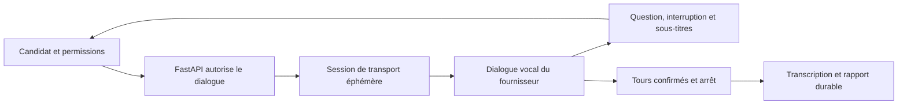

# SimuEmploi — maquettes des entretiens audio et vidéo

**20 novembre 2026 — conception ajoutée au dossier candidat.** Les maquettes texte précédentes ne couvraient pas ces modalités. Ce document complète désormais la conception avec audio, vidéo, réponse enregistrée et conversation en direct. Il ne constitue pas une implémentation de capture ou de dialogue IA.

## 1. Deux modalités et deux déroulements

| Modalité | Question par question | Conversation en direct |
|---|---|---|
| Audio | Question écrite/lue → prise au microphone → relecture → envoi autorisé → transcription → conseil | Dialogue vocal avec le coach, interruption, micro coupé, sous-titres, pause et reprise |
| Vidéo | Aperçu caméra → prise audio/vidéo → relecture → choix d’envoi → transcription de l’audio → conseil et relecture personnelle | Dialogue vocal avec aperçu vidéo local ; transmission caméra facultative, contrôles de capture et fin explicite |

Le choix de filmer, de transmettre, de conserver un replay et de générer des conseils reste distinct. La proposition garde la vidéo locale par défaut. Un envoi vidéo ou une transmission vidéo en direct demande un choix supplémentaire et une capacité réelle du service retenu.

Le dialogue vocal en direct exige une connexion disponible. Une réponse enregistrée peut être préparée localement si le navigateur et l’espace de stockage le permettent, puis envoyée après reconnexion. La maquette propose aussi une solution de secours texte.

## 2. Écrans à développer

| Écran | Contenu et actions | États et critères de réception |
|---|---|---|
| M01 — Choisir le déroulement | Audio/vidéo ; question par question ou direct ; objectif et durée indicative ; accès aux réglages | Choix explicite ; comprendre la différence entre répondre localement et dialoguer en ligne |
| M02 — Micro et caméra | Sélecteurs d’équipement, demande de permission à l’initiative du candidat, test voix/aperçu ; choix de transmission et replay pour le direct | Refus, équipement absent, bruit, connexion faible ; début bloqué si matériel requis indisponible ; alternatives audio/texte |
| M03 — Écouter la question | Question écrite toujours disponible, lecture vocale contrôlable, aide pédagogique | Lecture déclenchée par l’utilisateur ; arrêt/pause ; pas de dépendance exclusive au son |
| M04 — Enregistrer | Démarrer, pause/reprise, arrêter et relire ; compteur descriptif ; aperçu vidéo si choisi | Capture active explicitement signalée ; arrêt des tracks sur fin ; interruption, quota local et récupération traités |
| M05 — Relire sa prise | Lecteur, déplacement dans la prise, refaire avec confirmation ; choix d’envoi de l’audio et éventuellement de la vidéo | Relecture avant envoi ; nouvelle prise n’écrase pas silencieusement une réponse confirmée ; consentement d’envoi distinct |
| M06 — Envoi et reprise | Progression, fichier reçu non encore confirmé, reprise du même envoi | Coupure, timeout, fichier trop grand/invalide, reprise autorisée ; accusé après confirmation serveur ; pas de doublon |
| M07 — Transcription | Attente, lecture, correction fidèle, version confirmée ; accès à la prise | Reconnaissance incorrecte ou partielle ; correction versionnée ; aucune analyse sur une correction non confirmée |
| M08 — Retour sur la réponse | Point d’appui, conseil concret, prise accessible, prochaine question | Erreur IA, nouvelle tentative et continuation ; citations présentes dans la transcription liée ; limites explicites |
| M09 — Rapport | Objectif de progrès, sources utilisées, parties manquantes, disponibilité du replay | Distinguer contenu transcrit, mesures acoustiques éventuelles et vidéo disponible ; rapport partiel nommé |
| M10 — Direct | Le coach parle/le candidat répond ; interruption ; micro et caméra ; sous-titres ; prochaine question ; pause et fin | Refus/révocation, perte réseau, arrêt du fournisseur, reconnexion ; reprise à partir des tours confirmés, sans faux succès |
| M11 — Fin | Arrêt du dialogue/capture, état du rapport, replay selon le choix de conservation, nouvel entraînement | Fin de session distincte de rapport prêt ; replay absent annoncé ; aucune transmission continuée après fin |
| M12 — Secours texte | Même question et champ texte ; retour possible aux réglages | Transition explicite, sans perte des réponses confirmées ; aucun mélange silencieux entre deux prises/modalités |

Les sélecteurs d’écran, de situation et le carousel servent à la relecture de conception. Ils ne sont pas des contrôles de production. Les variantes « Entretien audio » et « Entretien vidéo » partagent les règles et donnent des commandes propres à leur modalité.

## 3. Permissions, consentements et contrôle

La permission du navigateur autorise l’accès à un équipement. Elle ne remplace pas l’information du candidat sur les transmissions, les prestataires et la conservation des données.

1. Demander le microphone ou la caméra après une action explicite et dans un contexte sécurisé HTTPS.
2. Montrer un état visible lorsque la capture est active. Un point rouge ne doit pas apparaître comme si le microphone enregistrait avant le démarrage.
3. En mode enregistré, séparer la prise locale de son envoi. Relire et valider avant de transmettre.
4. En direct, obtenir le choix de transmission avant d’ouvrir la session de dialogue ; proposer séparément la conservation d’un replay.
5. Garder l’aperçu vidéo local par défaut. Expliquer quand une image ou un flux vidéo quitte l’appareil.
6. Arrêter effectivement capture, transport et lecteur lorsque l’utilisateur termine, change de mode, révoque une permission ou quitte la session selon la politique retenue.

Les textes de notice de la maquette sont des propositions à compléter avant lancement : finalités, prestataires, pays de traitement, durées de conservation, accès et demandes de suppression. Une simple case précochée ne suffit pas à établir un choix explicite.

## 4. Relecture, transcription et retour

Le replay permet une auto-observation. La vidéo ne reçoit pas ici de note d’assurance, de personnalité, d’émotion ou de regard. Les anciens indicateurs simulés du prototype historique ne constituent pas une base d’évaluation fiable.

Une analyse de contenu s’appuie sur la transcription confirmée et la grille de la question. Si la reconnaissance se trompe, le candidat peut corriger les mots tout en restant fidèle à sa prise. Si le candidat souhaite changer sa réponse, il fait une nouvelle prise. Un rapport distingue les éléments réellement mesurés et les éléments manquants.

Des mesures acoustiques éventuelles nécessitent un lot distinct : définition, instrument, qualité du signal, validation avec différents accents, environnements et appareils. Elles ne sont pas remplacées par des nombres aléatoires ou des suppositions du modèle.

Le français parlé au Burkina Faso et le vocabulaire des métiers doivent faire partie du corpus d’essai de transcription. L’extension au Mali et au Niger demande une nouvelle relecture locale et des essais de langues/accent, sans supposer une qualité identique dans tous les pays.

## 5. Architecture compatible avec le backend Python

### Réponses enregistrées

- **Frontend React/TypeScript :** permissions navigateur, choix d’équipement, MediaRecorder, lecteur natif et Web Audio pour des tests techniques si nécessaire. Vérifier les codecs réellement disponibles avec `MediaRecorder.isTypeSupported` ; ne pas imposer WebM/VP9 à tous les navigateurs.
- **Module media dans FastAPI :** propriétaire, session/question/prise, autorisations, initialisation d’envoi, limite de taille/durée, progression, finalisation et accès privé au replay autorisé.
- **Stockage privé compatible S3 :** fichiers transmis sous identifiants opaques ; accès temporaires autorisés ; politique de suppression/expiration. La conservation serveur de vidéo reste un choix de produit, sans être requise par l’aperçu local.
- **Workers Celery :** transcription, contrôles de traitement, retour pédagogique, rapport. Le broker transporte les identifiants des travaux, pas les vidéos ou le texte brut complet des réponses.
- **PostgreSQL et outbox :** état des prises/transcriptions/évaluations et publication durable des travaux. La finalisation du fichier est vérifiée avant de déclarer sa réception ; stockage objet et transaction SQL ne sont pas supposés atomiques.

```mermaid
flowchart LR
  A[Prise locale] --> B[Relecture et choix d'envoi]
  B --> C[Envoi autorisé par FastAPI]
  C --> D[Stockage privé et confirmation]
  D --> E[État durable et outbox]
  E --> F[Worker de transcription]
  F --> G[Transcription à relire]
  G --> H[Version confirmée]
  H --> I[Évaluation pédagogique]
  I --> J[Rapport et replay autorisé]
```

### Conversation en direct

Le direct ajoute un module `realtime` et un adaptateur de fournisseur de dialogue : ouverture autorisée, droits, budget, session éphémère, interruption et fin. WebRTC est une option de transport à qualifier avec le fournisseur ; un protocole WebSocket audio peut être nécessaire selon celui qui est retenu. La latence et le coût restent à mesurer.

RabbitMQ et Celery gèrent les travaux différés ; ils ne sont pas le transport du flux audio interactif. Aucune clé fournisseur durable ne doit être remise au navigateur. La caméra n’est transmise que si la fonctionnalité est disponible et autorisée. Les flux sont fermés à la fin ; les travaux différés recontrôlent droits, entrées et suppressions.

`media` et `realtime` restent des modules séparés dans l’architecture initiale. Leur extraction en services peut suivre un besoin mesuré de charge, latence ou exploitation ; concevoir l’audio et la vidéo n’impose pas de multiplier immédiatement les microservices.

## 6. Reprise et stockage local à vérifier

La maquette n’enregistre aucun média. Le compteur, le lecteur, le fichier envoyé et les paroles sont simulés. Le texte corrigé et les choix restent seulement en mémoire pendant la consultation.

Dans le produit :

- Vérifier l’espace disponible, les quotas, les interruptions système et les particularités Safari/Android avant de promettre la récupération d’une prise.
- Si un brouillon doit survivre à une fermeture, stocker ses segments et métadonnées dans IndexedDB avec une politique de rétention, d’isolation par compte et de nettoyage.
- Distinguer prise en mémoire, segments réellement persistés et fichier final valide. Ne pas afficher « récupérable » sans preuve.
- Reprendre un envoi par identifiant/parties confirmées et autorisation courante. Une nouvelle tentative ne crée pas une deuxième réponse métier.
- Prévoir une reprise au premier plan ; la synchronisation automatique en arrière-plan ne doit pas être la seule solution sur mobile.
- En direct, distinguer tours confirmés et fragments non confirmés ; montrer la dernière étape disponible après coupure.
- Lors d’une déconnexion, suppression ou changement de compte, nettoyer les données locales et invalider les accès conformément à la politique retenue.

## 7. Organisation des développeurs et validation

La [proposition de lots audio/vidéo](06_LOTS_AUDIO_VIDEO_CINQ_DEVELOPPEURS.md) détaille les responsabilités D1–D5. Les maquettes sont disponibles dès la conception ; les dates et la capacité de développement doivent être réestimées avant engagement.

Priorité recommandée pour réduire les incertitudes : audio enregistré → vidéo avec relecture locale → dialogue vocal en direct → transmission vidéo en direct si elle répond à un besoin validé. Cette proposition n’ajoute pas les espaces recruteurs ou établissements au premier parcours candidat.

Recette sur de vrais appareils : refus/révocation de permission, micro/caméra absents, casque Bluetooth, appel téléphonique interrompant une prise, rotation, verrouillage, quota local, coupure pendant envoi, reprise après authentification, transcription locale imparfaite et dialogue interrompu. Les critères réseau, taille/durée et budget seront fixés après les premiers essais, pas déduits des maquettes.

Les résultats de relecture locale figurent dans [VERIFICATION_MAQUETTES_MEDIAS.md](VERIFICATION_MAQUETTES_MEDIAS.md).
