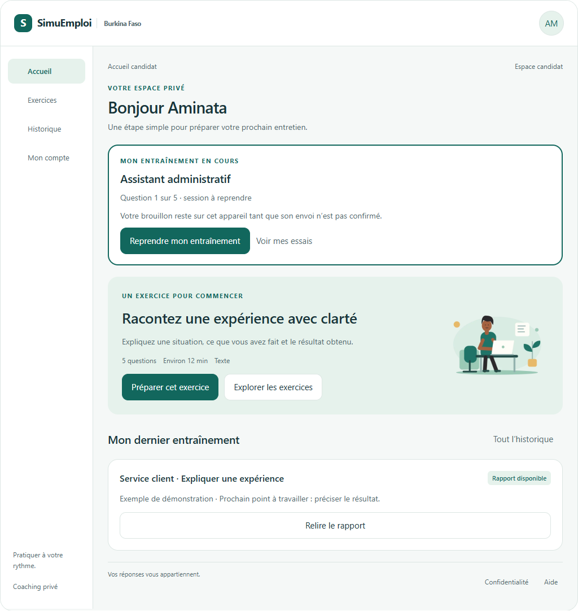
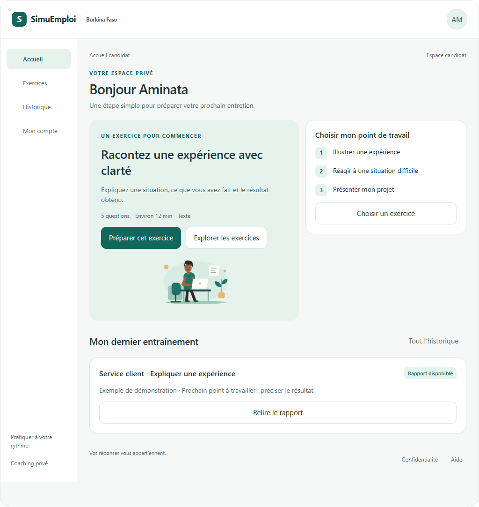
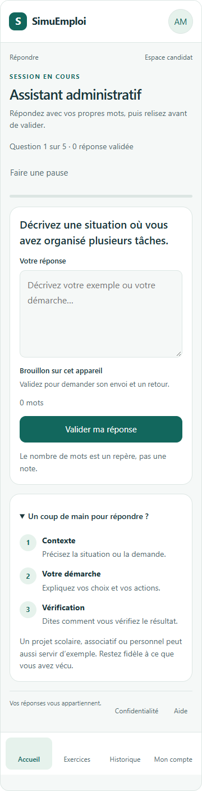
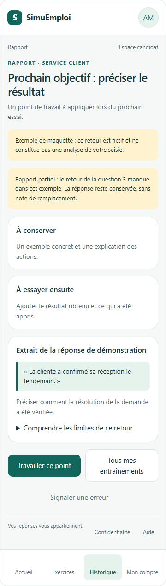
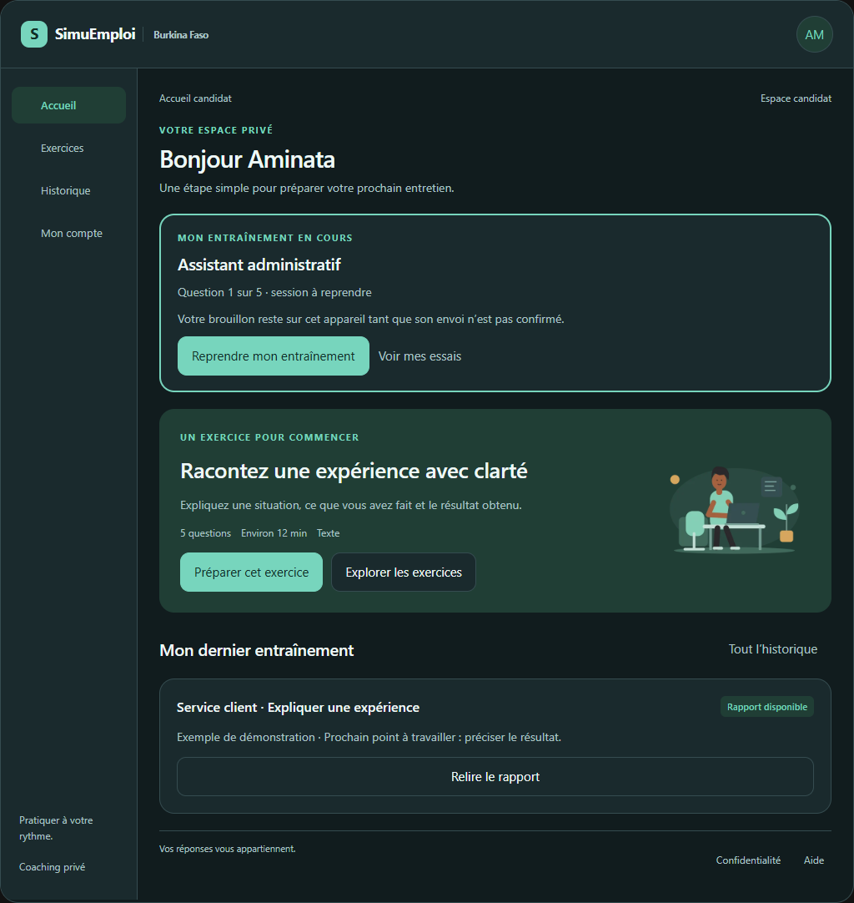
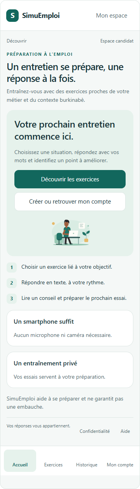
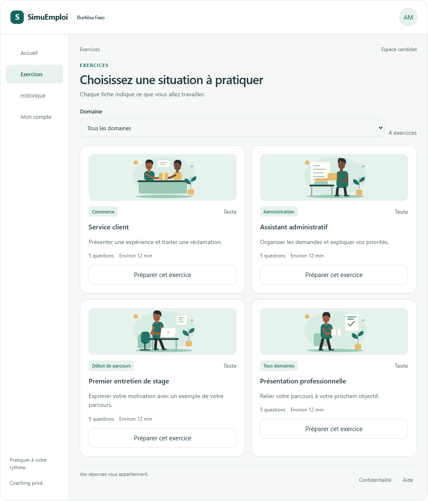
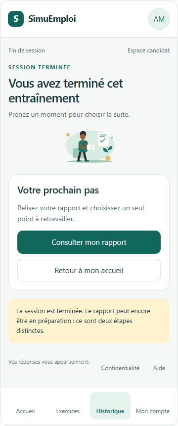

# Vérification des maquettes candidat

**Version 0.2 — 20 novembre 2026. Portée : proposition UI locale, pas application de production.**

- Douze écrans et deux variantes, avec un sélecteur de situations pour les états vides, chargement, coupure, échec et rapport partiel.
- Contrôle local dans Chrome headless : 96 combinaisons écran/variante/largeur (320, 360, 736 et 1024 px) sans débordement horizontal détecté ni erreur JavaScript de page.
- Trente contrôles supplémentaires des états dégradés sur six écrans du parcours guidé à 320 px.
- Interactions contrôlées : navigation, essai initial vide, validation et focus au champ, brouillon en mémoire pendant coupure, reprise depuis accueil, retour d'une réponse validée puis lecture seule, confirmation avant remplacement du brouillon de démonstration, question suivante, signalement simulé, rapport partiel, annulation de suppression et retour du focus, confidentialité ouvrable, filtre vide/réinitialisation, question et aide adaptées à l'exercice.
- Huit captures relues : accueil guidé desktop, réponse mobile, accueil autonome desktop, rapport partiel mobile, accueil guidé sombre, découverte mobile, catalogue illustré et fin mobile. La relecture a conduit à corriger les initiales du compte et à réduire l'espace des liens du pied de page sur mobile.
- Décodage des images et présence de l'attribut alternatif vérifiés dans les 96 combinaisons. Les illustrations décoratives ont une alternative vide. Cette vérification ne remplace pas une revue sémantique complète d'accessibilité.
- Aucune API, aucun fournisseur IA, paiement ou identité réelle n'est appelé. Les retours, noms et dates visibles sont des données de conception fictives.
- Les contrôles ne démontrent pas la persistance serveur, la sécurité, l'accessibilité complète ni le comportement sur téléphones réels. Ceux-ci sont des critères de recette des sprints.
- Le brouillon de démonstration reste uniquement en mémoire ; sa conservation après actualisation ou fermeture n'est pas implémentée.
- Le carousel et les contrôles de style sont fournis par le contexte de prévisualisation du chat. Le contrôle headless manipule les variantes localement ; il ne teste pas ce contexte hôte.

[Résultat machine](verification-maquettes.json) ; outil local : `outils/verifier-parcours-maquettes.cjs`.

## Captures de référence

Les captures sont des références de relecture. La maquette reste adaptable et les cinq développeurs doivent suivre une version partagée des écrans, contrats et états.
