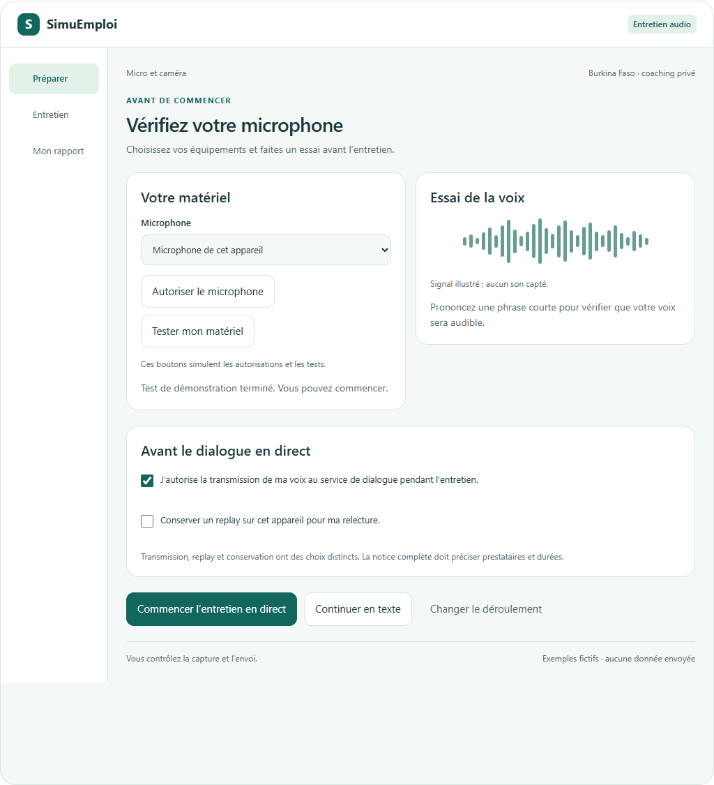
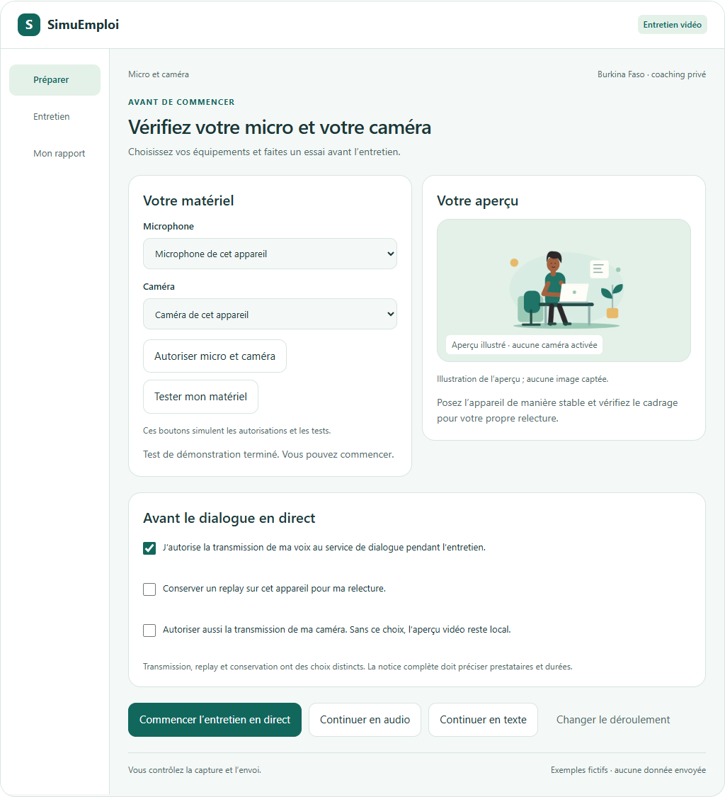
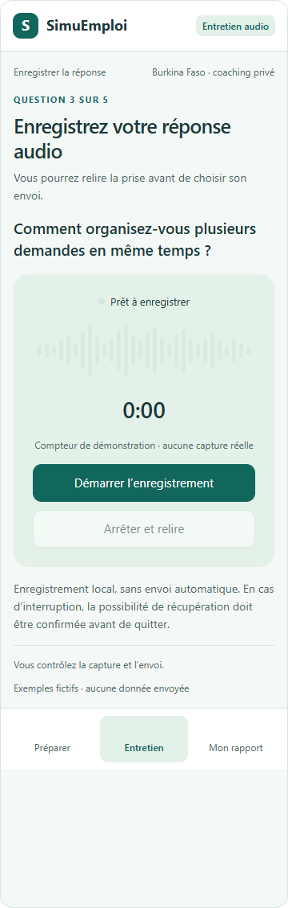
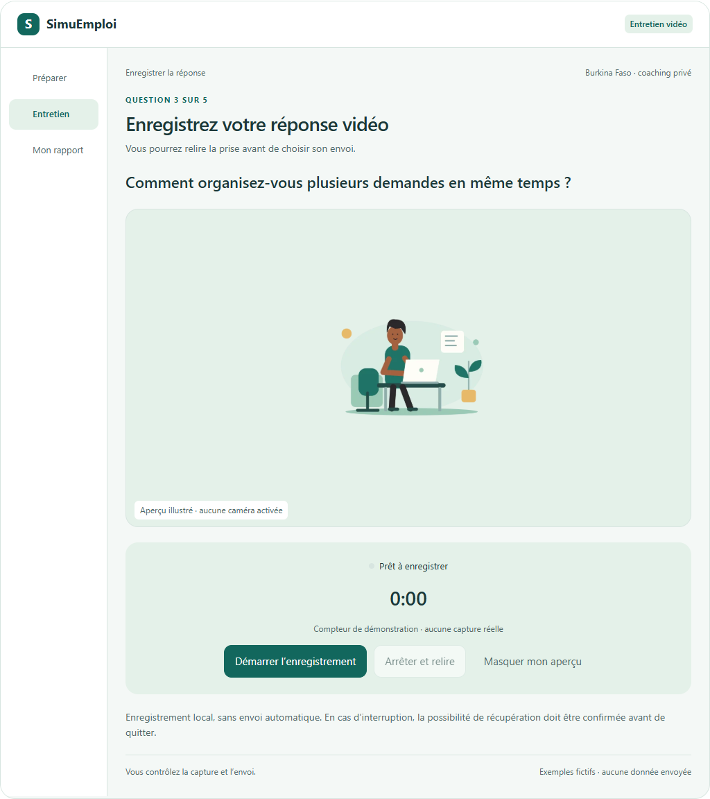
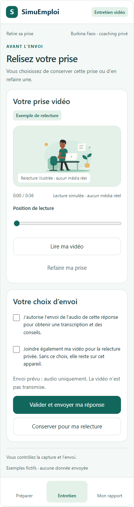
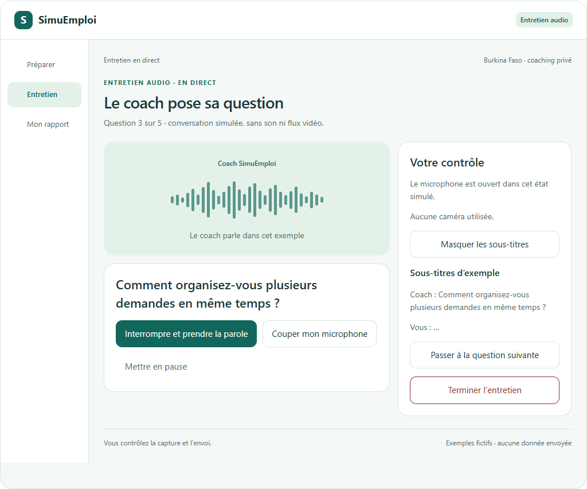
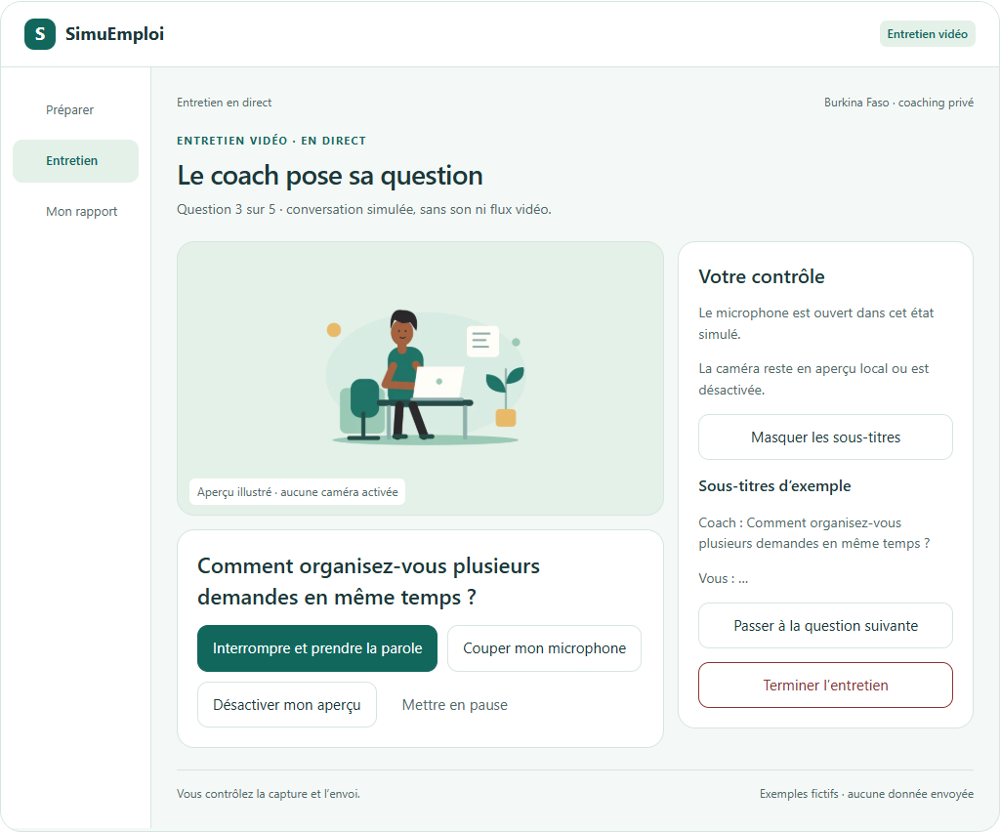
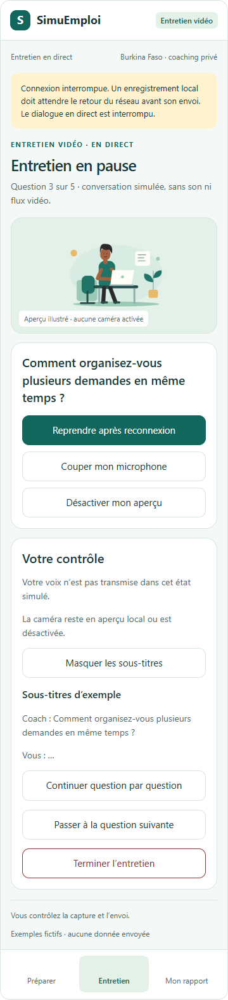
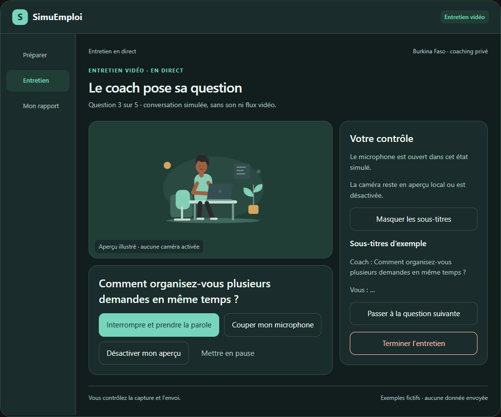

# Vérification des maquettes audio et vidéo

**20 novembre 2026. Portée : conception locale, sans capture réelle.**

- Douze étapes, deux modalités audio/vidéo et les déroulements enregistré/direct, avec une solution de secours texte.
- Chrome headless : 96 combinaisons étape/modalité/largeur à 320, 360, 736 et 1024 px, sans débordement horizontal ni erreur JavaScript détectés.
- 140 contrôles supplémentaires d’états dégradés à 320 px sur sept étapes, deux modalités et dix situations : permission refusée, micro absent, caméra absente, bruit, coupure, faible connexion, envoi interrompu, transcription en cours, analyse en échec et rapport partiel.
- Interactions vérifiées : autorisation/test simulés, prise/pause/arrêt, choix avant envoi, vidéo non transmise par défaut, reprise d’envoi, correction et version de transcription, échec IA, question suivante, relecture et remplacement confirmé, consentement du dialogue direct, micro coupé, interruption du coach, sous-titres, pause, transition vers prise enregistrée, fin confirmée, retour du focus, caméra absente vers audio et secours texte.
- Neuf captures relues, couvrant réglages, prise, relecture, direct, coupure mobile et apparence sombre. Le point d’état de capture a été ajusté pour rester neutre avant l’enregistrement ; la relecture possède un libellé distinct de l’aperçu.
- Images décodées et attributs alternatifs présents lors des contrôles de mise en page. Les illustrations sont décoratives.
- Aucun appel HTTP observé. Le source ne contient pas d’appel à getUserMedia, MediaRecorder, fetch ou transport réseau. Les boutons simulent leurs états ; aucun microphone, caméra, fichier réel, voix réelle ni fournisseur IA n’est utilisé.

[Résultat machine](verification-maquettes-medias.json) ; outil : `outils/verifier-maquettes-medias.cjs`.

La syntaxe des deux diagrammes du dossier médias est contrôlée séparément : [résultat](verification-diagrammes-medias.json), [prise enregistrée](diagrammes-medias/01-flux-prise-enregistree.mmd), [dialogue direct](diagrammes-medias/02-dialogue-direct.mmd). Une validation de syntaxe ne démontre pas les garanties de l’architecture.

## Captures

## Limites et contrôles à réaliser pendant le développement

Ces contrôles ne démontrent pas capture, encodage, stockage, reprise de fichiers, qualité acoustique, réseau temps réel, sécurité ou accessibilité complète. Les compteurs et lectures sont simulés, sans média réel. La correction de texte et les choix restent en mémoire pendant la consultation ; une actualisation peut les perdre.

La recette de production porte sur appareils et navigateurs réels, permissions/révocations, codecs, interruptions système, quotas locaux, transferts reprenables, fournisseur, transcription locale, coût, latence et nettoyage des données. Le carousel et les réglages de style relèvent du contexte du chat ; ils ne sont pas testés comme une fonctionnalité du produit.
