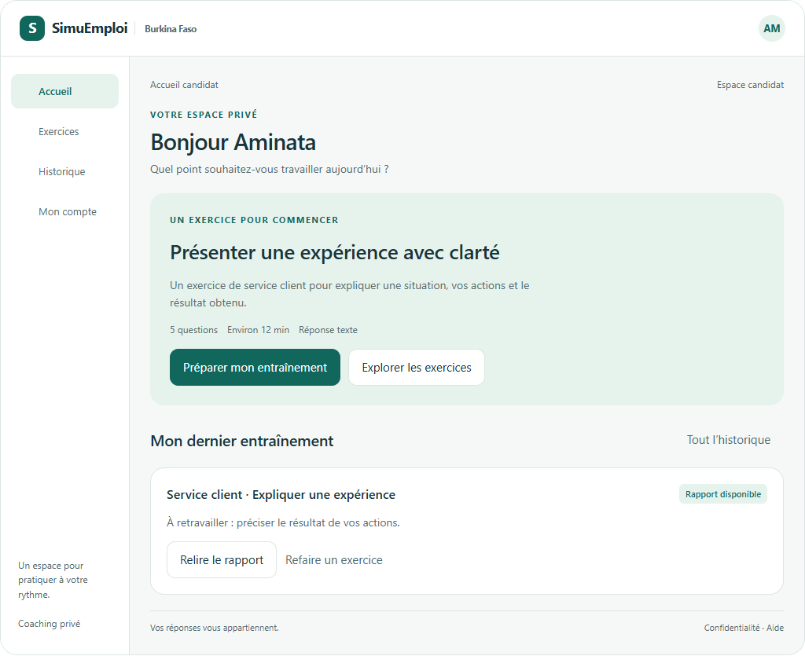
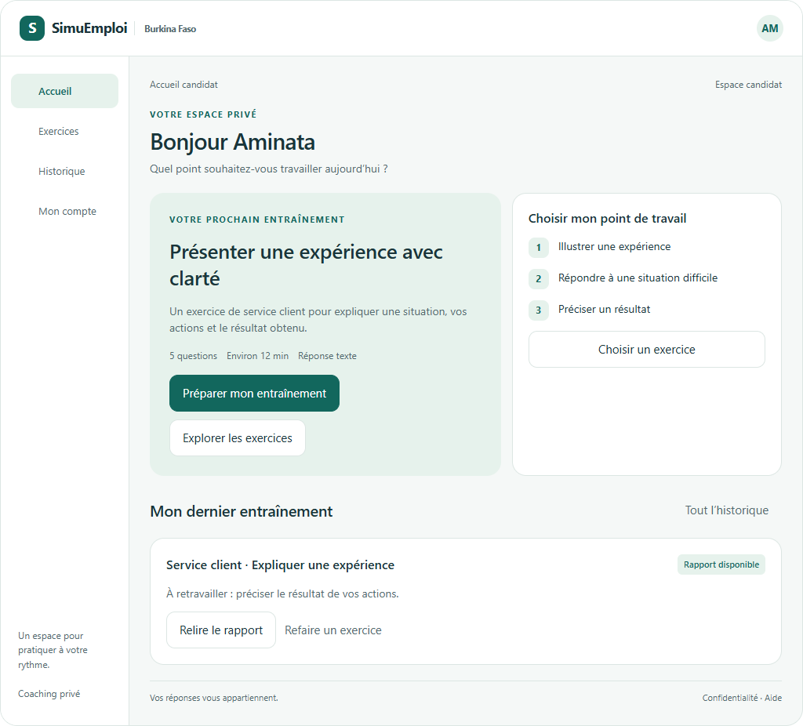
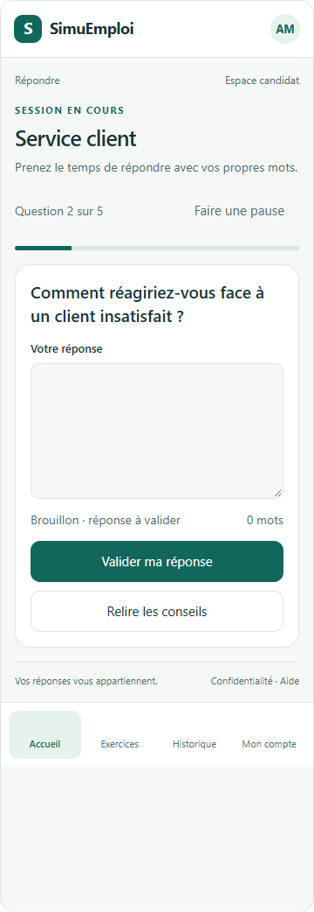
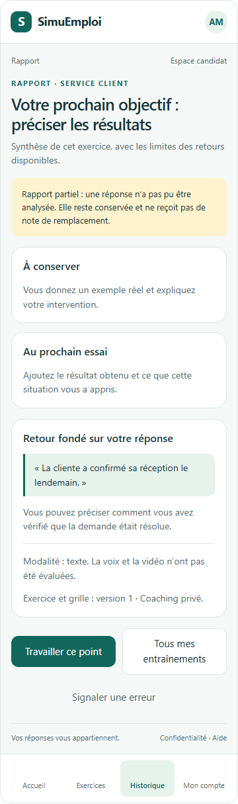
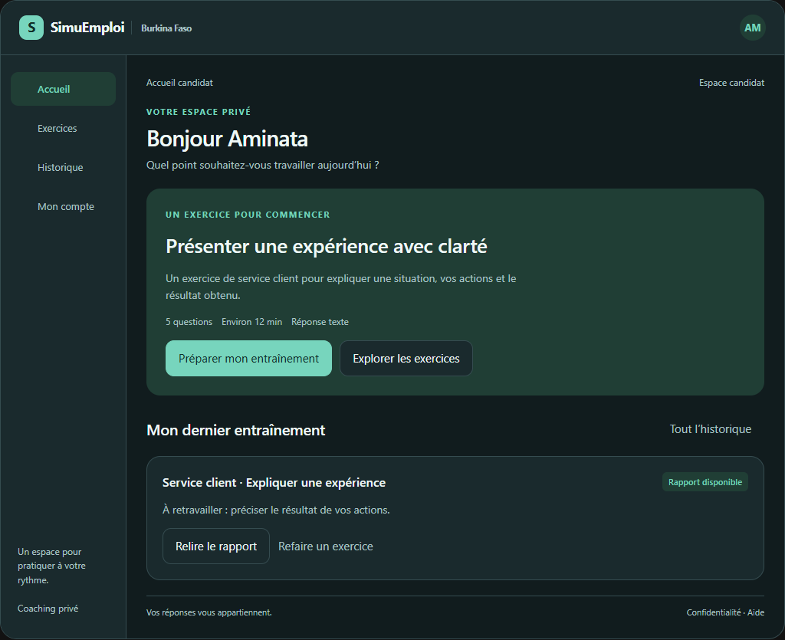

# Vérification des maquettes candidat

**20 novembre 2026. Portée : proposition UI locale, pas application de production.**

- Douze écrans et deux variantes, avec un sélecteur de situations pour les états vides, chargement, coupure, échec et rapport partiel.
- Contrôle local dans Chrome headless : 96 combinaisons écran/variante/largeur (320, 360, 736 et 1024 px) sans débordement horizontal détecté ni erreur JavaScript de page.
- Interactions contrôlées : navigation, validation de texte court, conservation locale simulée pendant coupure, pause/reprise, relecture finale en lecture seule, question suivante, rapport partiel et annulation d'une demande de suppression.
- Cinq captures inspectées : accueil guidé desktop, réponse mobile, accueil autonome desktop, rapport partiel mobile et accueil guidé sombre. Les textes inspectés ne sont ni tronqués ni superposés.
- Aucune API, aucun fournisseur IA, paiement ou identité réelle n'est appelé. Les retours, noms et dates visibles sont des données de conception fictives.
- Les contrôles ne démontrent pas la persistance serveur, la sécurité, l'accessibilité complète ni le comportement sur téléphones réels. Ceux-ci sont des critères de recette des sprints.
- Le carousel et les contrôles de style sont fournis par le contexte de prévisualisation du chat. Le contrôle headless manipule les variantes localement ; il ne teste pas ce contexte hôte.

[Résultat machine](verification-maquettes.json) ; outil local : `outils/verifier-parcours-maquettes.cjs`.

## Captures de référence

Les captures sont des références de relecture. La maquette reste adaptable et les cinq développeurs doivent suivre une version partagée des écrans, contrats et états.
