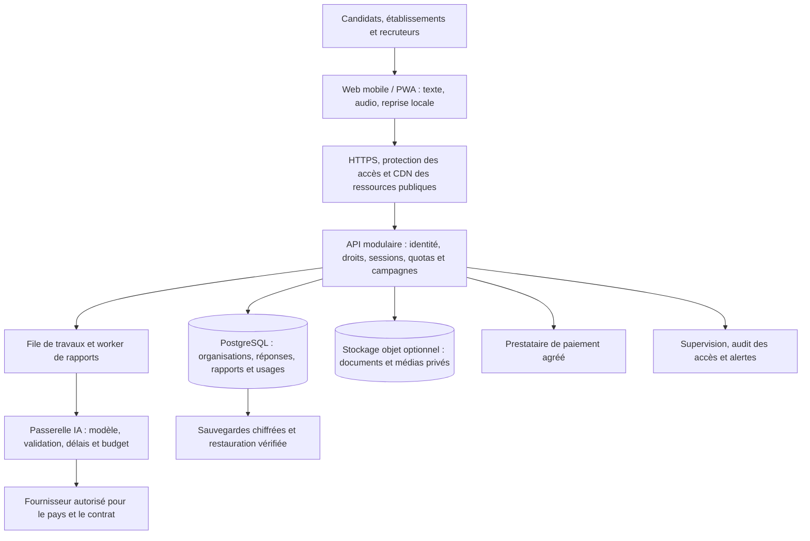

# SimuEmploi — étude de recadrage pour le Burkina Faso et l'AES

**Version : 1.0 — 20 novembre 2026**  
**Marché initial : Burkina Faso. Extension : Mali et Niger.**  
**Usages retenus : coaching individuel, accompagnement institutionnel et aide à l'évaluation pour les recruteurs.**

## 1. Décision générale

Le projet mérite d'être poursuivi. Il possède une base d'interface et un parcours pédagogique réutilisables, mais son état actuel correspond à un **prototype de démonstration**. Il ne constitue pas encore un service national fiable, et ses notes ne peuvent pas servir à prendre une décision de recrutement.

La priorité consiste à rendre les résultats honnêtes et vérifiables, assurer la conservation des sessions, protéger les données, fonctionner sur les équipements réellement utilisés et valider une offre économiquement accessible. Une extension géographique réussie repose ensuite sur les contenus, les partenariats, les règles juridiques et l'exploitation de chaque pays.

Le lancement recommandé conserve les trois usages demandés dans **un même produit**, avec trois espaces et des finalités explicitement distinctes. Le coaching peut être ouvert avant l'aide au recrutement. Cette dernière passe par un pilote séparé, une grille métier validée et une revue humaine effective avant toute utilisation opérationnelle.

### Promesse produit proposée

> SimuEmploi aide les candidats à préparer leurs entretiens et leurs oraux, et permet aux établissements et aux recruteurs de conduire des exercices structurés, avec des retours explicables sur les réponses et les compétences travaillées.

La formulation initiale « retour objectif sur la voix, la posture et la confiance » doit être révisée. La précision d'un score affiché ne démontre ni sa validité scientifique ni sa pertinence professionnelle. Le produit doit expliquer ce qu'il mesure, ce qu'il estime et ce qu'il ne peut pas conclure.

## 2. Base de l'étude et niveau de preuve

L'étude porte sur l'archive `simuemploi-ai---entretiens-&-coaching.zip` et sur le texte intitulé « CAHIER DES CHARGES & RAPPORT DE PROJET — SimuEmploi AI ». Ces deux éléments sont traités comme un seul projet. Le texte décrit les intentions et certains défauts ; le code permet de vérifier les fonctions présentes et les écarts.

Ont été examinés : serveur Express, configuration, contrats TypeScript, parcours de simulation, hooks audio et vidéo, génération et affichage des rapports, historique, configuration des scénarios, feedback et dépendances. Les vérifications techniques sont consignées dans un document séparé. Aucun entretien réel, jeu de données de validation, statistique de clientèle ni contrat fournisseur n'a été fourni.

Les recommandations chiffrées de capacité, de prix et de calendrier ci-dessous sont **des hypothèses de conception ou de test**, pas des résultats d'une enquête nationale. Aucune déclaration de conformité, de disponibilité réelle ou de précision de l'IA n'est déduite d'une simple lecture de code.

## 3. Ce qu'il faut conserver et revoir

| Élément | Décision | Motif |
|---|---|---|
| React, TypeScript, interface web | Conserver et modulariser | Base suffisante pour une PWA et les trois espaces |
| Node.js / Express | Conserver pour le démarrage | Un changement de langage serveur ne résout pas les défauts actuels |
| Scénarios et retour après réponse | Conserver, versionner et faire relire | Cœur du service pédagogique |
| Méthode STAR | Conserver pour les questions comportementales | Adaptée aux expériences vécues, insuffisante comme grille universelle |
| Scores vidéo et « assurance » | Retirer des évaluations ; remplacer par observations limitées | Actuellement simulés ou inférés sans validation |
| Rapport positif de secours | Supprimer | Un échec technique ne justifie pas une bonne note |
| Historique et progression | Reconstruire sur données persistantes | Les scores ne sont comparables qu'à conditions explicites |
| Enregistrement | Optionnel, local par défaut | Coûts, confidentialité, équipement et connexion |
| Gemini | Encapsuler et contractualiser | Dépendance fournisseur, coût, âge, pays disponibles et transferts |
| Freemium et pass | Conserver comme hypothèses | Prix, quotas et marge doivent être validés au Burkina |
| Abonnement illimité | Remplacer par consommation plafonnée | Risque d'abus et de marge négative |
| Comptes, sécurité, sauvegardes | Avancer avant le lancement public | Ce sont des prérequis d'exploitation |
| Vision cloud périodique | Déprioriser | Risque de confidentialité, de coût et de conclusions inappropriées |
| Extension AES | Préparer dès le modèle de données, ouvrir par pays | Un marché régional ne supprime pas les cadres nationaux |

## 4. Audit du code : corrections ordonnées par impact

**P0 : bloque une ouverture publique fiable ou un usage d'évaluation. P1 : nécessaire au pilote exploitable. P2 : amélioration ultérieure.** Les chemins sont relatifs à `projet-source/`. Les numéros correspondent à l'archive examinée.

| ID | Priorité | Constat vérifié et preuve | Ajustement nécessaire |
|---|---|---|---|
| A01 | P0 | `src/hooks/useRealtimeVideo.ts`, valeurs initiales et `Math.random()` dans l'intervalle : contact visuel, confiance et conseils ne mesurent pas le candidat | Supprimer les faux résultats ; afficher « non mesuré » ; conserver seulement des observations techniques validées |
| A02 | P0 | `InterviewRoom.tsx:384`, rapport de secours 86/100 et notes fixes lorsque `json.success` est faux | Statut « analyse indisponible » ; aucune note inventée ; sauvegarde et reprise |
| A03 | P0 | `server.ts:231`, l'analyse d'image échouée renvoie `success: true` avec valeurs fixes | Retour explicite d'échec ou de mesure indisponible ; journaliser l'erreur technique |
| A04 | P0 | `useRealtimeAudio.ts`, WPM plafonné entre 90 et 190, timestamps regroupés, « stabilité de pitch » issue du volume et pauses fixes 0,8/1,8 s | Mesurer le temps effectif, les mots et les silences ; enlever les conclusions psychologiques ; documenter l'incertitude |
| A05 | P0 | `server.ts:33` et routes suivantes : aucune authentification, autorisation ou limite de consommation implémentée | Identité ou jeton de découverte limité, quotas serveur, permissions par ressource, plafonds de coût |
| A06 | P0 | `server.ts:12` : JSON jusqu'à 50 Mo ; payloads non validés ; historiques et nombre de questions acceptés du client | Schémas d'entrée/sortie, limites par route, état serveur, contrôle taille et type |
| A07 | P0 | `server.ts:344` conserve `userEmail` ; `server.ts:364` restitue publiquement toute la liste | Réponse publique expurgée, espace administrateur authentifié, modération et rétention |
| A08 | P0 | `server.ts:96` et analogues : `JSON.parse` sans validation locale des résultats ; compteurs délégués au modèle | Valider types, bornes et cohérence ; le serveur décide de la progression et du calcul |
| A09 | P0 | Champs libres interpolés dans les prompts ; aucun mécanisme contre la manipulation d'instructions | Traiter les réponses et futurs CV comme données ; référentiels séparés ; tests adversariaux |
| A10 | P0 | Appels `fetch` et IA sans délai applicatif, annulation ou stratégie de reprise définie | Délais, erreurs typées, circuit de protection, reprise bornée et idempotence |
| A11 | P1 | `InterviewRoom.tsx:349` : sur échec de la dernière réponse, `handleFinishSession(questionHistory)` peut utiliser l'ancien état | Utiliser un historique cohérent et sauvegardé ; ne perdre aucune réponse validée |
| A12 | P1 | `InterviewRoom.tsx:433` : un échec réseau du rapport est seulement journalisé ; pas de sortie ou reprise organisée | Terminer et enregistrer la session même si le rapport est différé |
| A13 | P1 | `InterviewRoom.tsx:325` : feedback affiché, sans ajout au `newRecord` ni à l'historique sauvegardé | Persister l'évaluation de chaque réponse et sa provenance |
| A14 | P1 | `InterviewRoom.tsx:296` : durée d'une réponse fondée sur le chronomètre global, avec minimum 15 s | Chronomètre propre à chaque réponse, pause explicite, horodatage monotone |
| A15 | P1 | `InterviewRoom.tsx:290` : capture créée mais inutilisée ; aucun appel client à `/analyze-frame` | Désactiver la promesse d'analyse ; ne brancher ensuite que des mesures autorisées et utiles |
| A16 | P1 | `InterviewRoom.tsx:308` omet `selectedTechStack` dans le suivi ; le rapport omet catégorie, mode et scénario | Conserver la configuration complète côté serveur pendant toute la session |
| A17 | P1 | `server.ts:253` : toutes les catégories reçoivent un rapport d'entretien RH et STAR | Grilles spécifiques aux soutenances, concours, ventes et compétences techniques |
| A18 | P1 | `useRealtimeVideo.ts` demande `audio: false` ; `InterviewRoom.tsx:207` enregistre seulement `videoStream` | Composer les pistes si un replay audio/vidéo est demandé ; détecter les formats supportés |
| A19 | P1 | `recordedBlobUrl` sans usage dans le rapport ; `hasMediaRecording: true` imposé à `InterviewRoom.tsx:429` | Attendre l'arrêt effectif, gérer Blob/IndexedDB, lecture, téléchargement et état réel |
| A20 | P1 | `InterviewReportView.tsx:61` lit `question`, `userAnswer`, `feedback.instantAdvice`, absents du contrat | Corriger les champs, gérer feedback absent et échec du presse-papier |
| A21 | P1 | `App.tsx` : historique localStorage, initialisé avec une session de démonstration | Historique réel vide ; démonstration séparée ; stockage durable et migration versionnée |
| A22 | P1 | `server.ts:341` : feedbacks en RAM ; votes de `FeedbackSection.tsx` seulement locaux | Base persistante, pagination et règles anti-abus |
| A23 | P1 | `InterviewRoom.tsx:214` : tout transcript non vide actualise l'activité lors des mises à jour audio ; le silence peut ne pas se déclencher comme prévu | Détecter nouvelle parole/activité réelle ; validation automatique désactivée par défaut et testée |
| A24 | P1 | Reconnaissance vocale reconstruite sur `isListening`, sans nettoyage de l'effet ; démarrage asynchrone des médias sans garde complète au démontage | Un cycle de vie explicite ; libération des pistes, écouteurs, contextes et URL ; tests de navigation |
| A25 | P1 | `startRecording` dépend de `isRecording` et peut être redéclenché après un arrêt tant que le flux existe | Piloter l'enregistrement par l'état de session et l'action utilisateur |
| A26 | P1 | `server.ts:10` port fixe ; `package.json` start sans définition de `NODE_ENV`, pourtant nécessaire à la branche production | Configuration de déploiement, `PORT`, arrêt propre, routes health/readiness, dépendances runtime adaptées |
| A27 | P1 | Scores radar « Attendu » codés en dur ; agrégation de sessions différentes sans version de grille | Retirer le benchmark non validé ; comparaison par grille, exercice, langue et version |
| A28 | P1 | Pas de procédure CI, tests métier, sauvegarde ou supervision dans l'archive | Pipeline minimal puis tests ciblés des risques, alertes et restauration exercée |
| A29 | P2 | Bloc outils dupliqué dans `SetupScreen.tsx` ; filtre secteur non exposé ; secteurs déclarés mais absents du catalogue | Simplifier la configuration et harmoniser les référentiels |
| A30 | P2 | `index.html` conserve langue anglaise et titre générique ; README cite un autre modèle/service | Identité, localisation, documentation de lancement et version de produit |
| A31 | P1 | Le contrôle `tsc --noEmit` passe, mais le gestionnaire de copie laisse `item` en `any` ; pas de mode strict ni de dépendance déclarée `@types/react` | Ajouter les types React, renforcer les contrats et activer les contrôles stricts par étapes |

Deux précisions évitent d'exagérer l'audit : la clé Gemini est bien lue côté serveur, ce qui est un bon choix ; le compteur de « euh » fonctionne sur l'exemple contrôlé. Les limites principales de l'audio concernent le calcul et l'interprétation des métriques, pas une erreur prouvée de cette expression régulière.

Le contrôle TypeScript existant a été exécuté avec succès sur les dépendances résolues pour l'audit. Cela n'invalide pas A20 : le diagnostic du compilateur montre que l'objet de cette ligne est typé `any`. La compilation de production a été tentée mais bloquée par les restrictions de lecture du sandbox ; son exécution hors sandbox n'a pas été autorisée. Le build est donc **non validé**, sans conclure à une erreur de compilation propre au code. Le lock Bun original n'a pas été appliqué à l'installation pnpm de vérification ; les versions originales et installées sont consignées séparément.

## 5. Périmètre adapté au Burkina Faso

### 5.1 Trois espaces, des règles de partage différentes

**Espace candidat.** Entraînement privé, choix texte/audio, transcription corrigeable, exercices courts, rapport pédagogique, progression et partage choisi. Un employeur n'accède pas à l'historique de coaching personnel par défaut.

**Espace établissement.** Comptes de formateurs, groupes, exercices attribués, suivi de participation et retours pédagogiques. Les rapports individuels restent accessibles selon une règle annoncée avant l'exercice. Les statistiques de groupes très petits ne sont pas présentées comme anonymes.

**Espace recruteur.** Campagnes séparées, compétences définies avant les invitations, exercices pertinents pour le poste, rapport avec extraits probants, revue humaine et procédure de contestation. Les scores de visage, regard, accent, confiance présumée et personnalité sont exclus des critères de sélection. L'évaluation de la communication doit elle-même être justifiée par le poste et adaptée aux handicaps.

L'administration de plateforme gère le service et les incidents. Elle n'obtient pas un accès courant illimité aux réponses privées : assistance exceptionnelle, justifiée, limitée et journalisée.

### 5.2 Contenus locaux

Le catalogue initial est centré sur la tech, les grandes écoles françaises et les pitchs VC en euros. Pour le pilote, préparer **30 à 50 scénarios relus localement**, avec des partenaires métier. Cette quantité est un objectif de production, pas une preuve de couverture nationale.

Priorités à confirmer avec les acteurs burkinabè : postes administratifs et commerciaux, banque/microfinance, comptabilité, service client, ONG/projets, logistique, agroalimentaire, maintenance/industrie/mines, enseignement et numérique. Les métiers artisanaux et techniques doivent pouvoir valoriser l'expérience pratique, même sans parcours universitaire.

Exemples de nouveaux exercices : expliquer une expérience de vente et un objectif atteint ; organiser une activité de terrain sous contrainte ; présenter un budget de projet ; traiter une réclamation ; défendre un mémoire ; résoudre une panne simple ; argumenter un choix de sécurité. Les références au secteur public ou aux concours utilisent des informations officielles à jour, avec date de relecture, sans annoncer des questions officielles ou une validation de l'administration.

STAR s'applique aux récits d'expérience. Une soutenance utilise une grille problématique/méthode/résultats/limites ; un oral de concours une grille connaissances/raisonnement/expression ; un cas technique une grille diagnostic/solution/justification/sécurité. Une bonne réponse ne doit pas fabriquer une expérience ou des chiffres.

### 5.3 Accès et langues

Concevoir d'abord pour smartphone Android et connexion irrégulière, puis mesurer cette hypothèse sur le terrain. Tester également iOS, ordinateurs de centres de formation et appareils partagés. La caméra reste facultative ; un parcours texte complet doit être disponible.

Français pour l'ouverture, avec interface prête à être traduite et scénarios localisés par pays. Les langues nationales ne se réduisent pas à un changement de `fr-FR` : il faut des contenus relus, une transcription évaluée et des tests d'usage. Les priorités — par exemple mooré, dioula/bambara, fulfulde, haoussa ou zarma — seront établies avec les publics de chaque pays. Elles ne sont pas annoncées comme déjà couvertes.

Le mode connexion limitée permet de lire les ressources, répondre et retrouver une session interrompue. Le mode réellement hors ligne utilise une banque de questions et un retour déterministe limité, avec synchronisation choisie au retour du réseau. Un cache PWA ne rend pas une API IA disponible sans Internet.

Sur appareil partagé : fermeture de session, absence de jetons sensibles dans localStorage, possibilité d'effacer le cache personnel, sauvegarde locale annoncée et limitée. Ne pas conserver automatiquement une vidéo volumineuse.

## 6. Architecture cible et données

### 6.1 Choix proportionné

Démarrer avec un **monolithe modulaire**, une API, une base PostgreSQL, un stockage objet facultatif et un worker pour les rapports. Cela rend le système testable et exploitable sans introduire d'emblée la complexité de nombreux microservices.

L'API enregistre une réponse avant d'appeler l'IA. Elle crée un identifiant serveur, contrôle le propriétaire et les limites, puis renvoie un statut stable. Le client ne transmet plus un historique libre qui ferait autorité. Le serveur applique la version de grille et détermine si l'exercice se termine.

Un rapport peut être `pending`, `ready`, `partial` ou `failed`. Le worker accepte les reprises sans créer plusieurs rapports ni plusieurs consommations facturées pour une même opération. Une indisponibilité fournisseur n'efface pas la session.

### 6.2 Modèle de données minimal

Prévoir : `users`, `organizations`, `memberships`, `cohorts`, `scenarios`, `scenario_versions`, `rubrics`, `rubric_versions`, `sessions`, `questions`, `answers`, `evaluations`, `reports`, `campaigns`, `campaign_participants`, `share_grants`, `consents`, `usage_ledger`, `payments`, `webhook_events`, `feedbacks`, `audit_events` et `deletion_requests`.

Chaque ressource porte son propriétaire ou son organisation et, si utile, `country_code`, `locale`, `purpose`, `retention_policy`, `created_at` et `deleted_at`. Une évaluation conserve modèle, version du prompt, version de grille, statut de production et références aux réponses justifiant le résultat. La configuration technique ne doit pas apparaître comme un obstacle dans le parcours utilisateur.

PostgreSQL constitue la source de vérité. IndexedDB sert à la reprise locale et aux exercices hors ligne, pas à authentifier l'utilisateur ni à définir ses droits. Une URL Blob est temporaire ; elle ne remplace pas un fichier sauvegardé.

### 6.3 Hébergement et extension

Choisir le lieu d'hébergement après cartographie des données, exigences des clients, qualité de service, coût et formalités de transfert. Un datacenter national n'empêche pas un transfert si l'IA, la transcription, la messagerie, les logs ou les sauvegardes utilisent des services étrangers.

Préparer trois profils de pays et la possibilité de séparer les données d'une organisation. Démarrer dans une région principale conforme au périmètre autorisé, avec haute disponibilité adaptée et sauvegardes dans des emplacements autorisés. Ne promettre ni souveraineté complète ni résidence géographique que les fournisseurs ne garantissent pas contractuellement.

Un futur déploiement entièrement local est une option à étudier pour certains clients. Il impose aussi des évaluations du modèle, des compétences d'exploitation, de la puissance de calcul et une estimation de coût ; il ne résout pas automatiquement les problèmes de qualité.

## 7. Protection des données et évaluation

### 7.1 Burkina Faso : prendre en compte la réforme de 2026

Le portail officiel publie la **loi n°037-2026/ALP du 3 août 2026**, promulguée le 22 septembre 2026, ainsi que la loi organique n°038-2026/ALP relative à l'organe de régulation. La référence de 2021 ne suffit donc plus. Les articles 34 à 37 organisent les formalités ; l'article 46 encadre les transferts et leur autorisation préalable. La qualification du service et des traitements d'aide à la décision doit être examinée avec l'autorité compétente, en tenant compte de la transition institutionnelle. Sources : [textes publiés sur le site de la CIL](https://cil.bf/?page_id=1017), [texte officiel de la loi de 2026](https://legiburkina.gov.bf/documents/01a1537f-ab52-7355-a6fc-fe0adcb78dc4/download).

Avant ouverture : responsable identifié, registre des traitements, cartographie des sous-traitants et lieux de traitement, finalités et bases applicables, notices compréhensibles, contrats de confidentialité/réversibilité, formalités nécessaires, politique de conservation et protocole d'incident. Le partage avec un recruteur et le transfert à un fournisseur sont deux opérations différentes à documenter.

### 7.2 Mali et Niger

Au Mali, la Primature publie la loi n°2013-015 et les compétences de l'APDP ; son article 2 encadre notamment les décisions produisant des effets juridiques fondées seulement sur certains traitements informatiques. Au Niger, la HAPDP présente la loi n°2022-59, modifiée par la loi n°2023-31. L'ouverture dans chaque pays exige une vérification des versions en vigueur, des formalités, des contrats et des transferts. L'appartenance à l'AES ne crée pas à elle seule une autorisation commune. Sources : [Primature du Mali](https://primature.ml/apdp-autorite-de-protection-des-donnees-a-caractere-personnel/), [législation publiée par la HAPDP](https://www.hapdp.ne/legislation-nationale).

### 7.3 Conditions du fournisseur IA

Les conditions Gemini consultées imposent des restrictions d'âge et interdisent d'intégrer ces services dans une application destinée ou susceptible d'être accessible aux moins de 18 ans. Elles distinguent aussi les usages payants et gratuits des données. **Recommandation : pilote réservé aux adultes**, tant que le fournisseur et le cadre pour les mineurs ne sont pas adaptés. Une autorisation parentale ne remplace pas les conditions du prestataire. Une offre gratuite pour le candidat peut utiliser une infrastructure payante financée par SimuEmploi. Source : [conditions Gemini API](https://ai.google.dev/gemini-api/terms).

La documentation confirme l'existence de `gemini-3.6-flash`, qui accepte les sorties structurées ; sa compatibilité effective avec la version SDK installée, les quotas et le compte du projet reste à tester. Le nom du modèle doit être configuré et ses changements évalués. Source : [documentation du modèle](https://ai.google.dev/gemini-api/docs/models/gemini-3.6-flash).

### 7.4 Ouverture internationale ultérieure

Pour un marché européen, examiner le RGPD et la qualification AI Act. Le règlement européen interdit certaines inférences d'émotions en contexte professionnel ou éducatif et classe des usages de recrutement/évaluation parmi les systèmes à haut risque. Le traitement local ne supprime pas cette question. L'étude recommande donc de garder les observations de cadrage séparées de toute appréciation de personnalité ou décision professionnelle. Source : [règlement européen sur l'IA, version consolidée](https://eur-lex.europa.eu/eli/reg/2024/1689).

### 7.5 Règles de confiance du produit

- Aucune note fictive, benchmark inventé ou promesse de probabilité d'embauche.
- Chaque commentaire important renvoie à un extrait de réponse ou à un critère observable.
- Transcription relue avant validation ; les erreurs de reconnaissance ne deviennent pas des défauts de compétence.
- Une modalité indisponible est indiquée « non mesurée » et n'est pas remplacée par une note moyenne.
- Aucune inférence de santé, origine, personnalité ou assurance à partir du visage ou de la voix.
- La progression compare des exercices et versions de grilles compatibles ; les changements de modèle sont visibles dans les analyses.
- Une décision de recrutement est justifiée par une personne compétente qui peut contredire l'outil. La simple approbation automatique du score n'est pas une revue humaine.
- Un candidat peut consulter ses données, signaler une erreur et demander une révision selon la finalité du traitement.

Les critères d'accessibilité suivent un objectif **WCAG 2.2 AA**, à vérifier par audit automatisé et manuel. Clavier, lecteur d'écran, sous-titres/transcription, contrôle du temps et alternatives aux médias font partie du périmètre. Source : [référentiel W3C](https://www.w3.org/TR/WCAG22/).

## 8. Sécurité et exploitation

Authentification gérée ou protocole éprouvé, MFA pour les administrateurs et comptes à privilèges, sessions sécurisées, contrôle des rôles et des ressources côté serveur. Tests systématiques d'accès entre organisations : connaître un identifiant ne doit jamais suffire à lire une session.

Protéger les endpoints IA par limites par utilisateur, organisation et IP, budget global et concurrence maximale. Un visiteur de découverte peut utiliser un jeton temporaire limité. Ajouter validation stricte, taille maximale, erreurs expurgées, protection CSRF si cookies, politique CORS et en-têtes adaptés, chiffrement en transit et au repos et gestion des secrets hors code.

Pour les futurs CV : formats autorisés, contrôle taille, extraction isolée, analyse des fichiers et suppression planifiée. Le texte importé ne doit pas modifier les règles d'évaluation. Un import par URL nécessite aussi une protection contre l'accès à des adresses internes ; pour le lancement, préférer dépôt de fichier et collage de l'offre.

Journaliser les événements d'accès et d'exploitation sans y placer par défaut les transcriptions, images, CV ou prompts complets. Prévoir corrections de dépendances, mise à jour régulière, CI, revue de code, environnements séparés, déploiement reproductible et retour arrière.

Définir un responsable d'exploitation, des horaires d'assistance et une procédure d'astreinte proportionnée. Exercer une restauration avant le pilote et régulièrement après lancement. La réplication d'une base ne remplace pas une sauvegarde.

## 9. Capacité : dimensionner sur l'activité réelle

Les comptes inscrits ne suffisent pas pour dimensionner. Mesurer utilisateurs actifs, sessions simultanées, appels IA/seconde, longueur des réponses, génération de rapports, stockage et coût par session.

| Palier de conception | Objectif de test proposé | Finalité |
|---|---|---|
| Pilote Burkina | 200–500 participants recrutés, 50 sessions simultanées | Vérifier parcours, coût et qualité sur appareils réels |
| Ouverture Burkina progressive | 200 sessions simultanées ; paliers jusqu'à 1 000 sessions/jour | Valider exploitation et quotas avant promotion large |
| Extension AES | Test de 500 sessions simultanées puis montée selon contrats | Séparer les contraintes de chaque pays |

Ces nombres sont des cibles initiales à réviser, pas une prévision commerciale. Dans le code actuel, une session de **Q questions** utilise environ **Q + 2 appels textuels IA** : démarrage, évaluation de chaque réponse et rapport. À six questions, 1 000 sessions/jour représentent environ 8 000 appels, hors reprises et vision.

Une capture toutes les 15 secondes sur 15 minutes ajoute 60 appels par session. Cela porterait le total à environ 68 appels au lieu de 8. Cette illustration explique pourquoi la vision périodique doit être justifiée avant son développement.

Cibles proposées pour l'ouverture Burkina : disponibilité API et données ≥99,5 %/mois, réponses ordinaires API p95 <500 ms hors IA, suivi IA p95 <10 s, rapport p95 <60 s avec possibilité de différer, perte de données après incident majeur ≤24 h au pilote puis ≤1 h à l'ouverture, restauration ≤4 h. Le taux de complétion est suivi séparément pour parcours normal et mode dégradé. Les délais IA ne sont pas des garanties du fournisseur.

La réception vérifie ces valeurs sur un protocole daté : volume, durée, réseau, appareils, scénario de panne et dénominateur de chaque mesure. Il faut aussi tester les débuts de campagnes simultanés, les webhooks répétés et un fournisseur lent.

## 10. Modèle économique local

Les tarifs 9,99 € et 19,99 € du texte ne sont pas validés pour le Burkina. À la parité publiée par la BCEAO, ils représentent environ **6 553 FCFA** et **13 113 FCFA**. Cette conversion ne mesure pas la disposition à payer. Source : [BCEAO, cours des devises](https://downloads.bceao.int/index.php/fr/cours/cours-de-reference-des-principales-devises-contre-Franc-CFA).

Tester des prix **en FCFA**, avec plafond d'usage annoncé. Hypothèses de test : découverte limitée ; séance courte 300–1 000 FCFA ; pack de cinq exercices 1 500–4 000 FCFA ; offre mensuelle plafonnée 3 000–6 000 FCFA. Ce sont des options d'enquête, pas des prix conseillés comme déjà rentables. Un pilote sponsorisé peut donner l'accès gratuit sans modifier le coût réel du service.

Pour les établissements : combinaison de licence de service, comptes actifs et volume inclus ; devis selon cohorte, assistance et personnalisation. Pour les recruteurs : facturation par campagne et volume de candidats, sans payer pour un verdict automatique. Ne pas transformer les données privées des candidats en revenu publicitaire ou en base de recrutement vendue sans finalité et autorisation appropriées.

Les paiements passent par un prestataire autorisé et réellement disponible dans le pays. Vérifier Mobile Money, règlement en XOF, frais, délai de reversement, remboursements et intégration marchande. Ne pas supposer qu'une intégration Stripe seule couvre les trois marchés. La BCEAO publie des listes d'établissements agréés qui doivent être recontrôlées lors du choix. Source : [liste publiée au 31 août 2026](https://downloads.bceao.int/index.php/fr/communique-presse/liste-des-etablissements-de-paiement-agrees-dans-lumoa-au-31-aout-2026).

Le serveur vérifie chaque paiement et webhook, déduplique les événements et tient un registre de crédits. Un paiement au statut incertain reste en rapprochement ; l'écran de retour du prestataire ne suffit pas pour créditer le compte. Prévoir un canal de facturation institutionnelle en plus des paiements individuels.

### Économie par session

`Marge de contribution = prix encaissé hors taxes − frais paiement − coût IA/STT/TTS − stockage/bande passante variables − assistance variable − remboursements/fraude.`

Illustration comptable, **sans tarif fournisseur réel** : 500 FCFA encaissés nets, 25 de paiement, 100 d'IA, 20 d'infrastructure variable et 30 d'assistance donnent 325 FCFA de contribution. Avec 1 500 000 FCFA de charges fixes mensuelles supposées, le seuil est d'environ 4 616 sessions payantes/mois. Si l'IA coûte 300 au lieu de 100, la contribution tombe à 125 et le seuil devient 12 000. Il faut mesurer les coûts avec des réponses et durées réelles, notamment leur p95.

L'étude ne chiffre pas artificiellement un marché national. La taille adressable doit partir de partenaires contactés, cohortes accessibles, fréquences d'usage et taux de conversion observés. Les populations étudiant/candidat/recruteur ne doivent pas être additionnées sans retirer les doublons.

## 11. Plan de validation terrain

Conduire des entretiens exploratoires avec environ 20–30 candidats, 5–10 établissements et 5–10 recruteurs burkinabè. Inclure Ouagadougou, Bobo-Dioulasso et au moins un terrain hors des deux principaux centres, dans des conditions d'accès praticables. Cette démarche exploratoire ne constitue pas une enquête représentative nationale.

Vérifier appareils, coût/qualité de connexion, durée acceptable, paiement, métiers, valeur du retour et crainte d'un partage avec l'employeur. Identifier des partenaires d'insertion, écoles, centres de formation et entreprises ; ce sont des catégories de partenaires à approcher, pas des partenariats déjà acquis.

Pour la qualité de l'évaluation : créer au moins 100–200 réponses de référence couvrant plusieurs métiers, niveaux et formes d'expression, avec double relecture humaine et résolution des désaccords. Distinguer corpus synthétique, tests internes et données de personnes consentantes. Tester répétabilité, exactitude des extraits, limites de transcription et écarts entre groupes pertinents sans inférer l'origine des personnes.

Pilote de 200–500 participants à usage progressif. Mesurer complétion, utilité du retour, retours de formateurs, réutilisation, incidents, coût médian/p95 et volonté de payer. Pour le recruteur, réaliser d'abord une évaluation en parallèle de la méthode habituelle : l'outil n'oriente pas la sélection pendant sa validation. Ni satisfaction élevée ni concordance avec un recruteur ne prouvent à elles seules l'absence de biais.

## 12. Feuille de route et responsabilité

Les durées sont des **estimations de planification** pour une petite équipe compétente ; les délais réglementaires et commerciaux s'ajoutent. Chaque ouverture dépend de critères de réception, pas seulement d'une date.

| Étape | Horizon indicatif à partir du démarrage effectif | Livrables et décision |
|---|---|---|
| 0 — Recadrage et terrain | 2–4 semaines | Usages, dossier données/fournisseurs, partenaires pilotes, grilles locales, architecture et budget |
| 1 — Socle fiable | 4–8 semaines | Corrections P0/P1 critiques, identité, sessions persistantes, quotas, reprise, rapport honnête, CI |
| 2 — Pilote Burkina | 4–6 semaines | Contenus locaux, accès établissements, paiement pilote, tests de charge et restauration, mesure pédagogique |
| 3 — Ouverture Burkina | 6–10 semaines après un pilote concluant | Support, contrats, montée progressive, facturation, suivi coûts et qualité |
| 4 — Aide au recrutement | En parallèle du travail de validation, ouverture conditionnelle | Campagnes, référentiels, formalités, double revue, contestation, validation avant impact sur sélection |
| 5 — Extension Mali / Niger | Après stabilité Burkina et préparation locale | Un pilote et un dossier par pays, partenaires, paiement, contenus et exploitation |
| 6 — Autres marchés | Selon demande et qualification | Langues, réglementations et hébergement adaptés ; calendrier non imposé |

Équipe minimale par rôles : responsable produit/partenariats, développeur full-stack, compétence backend/données/exploitation, référent pédagogique ou RH local, accompagnement juridique/protection des données et QA/accessibilité. Certaines responsabilités peuvent être cumulées, mais doivent être nommées. Le porteur décide du produit et du budget ; les enseignants/RH valident les grilles ; le responsable technique garantit les opérations ; le responsable données pilote les formalités et les droits.

Le budget est établi par lots : développement, contenus/relecture, juridique, équipement de test, hébergement/IA, paiements, support et acquisition. Utiliser des devis et la consommation du pilote, avec réserve d'aléas. Un montant global précis serait prématuré sans équipe, disponibilité et prestataires identifiés.

## 13. Critères d'ouverture et décisions à prendre

**Ouverture coaching Burkina** : résultats sans notes fictives ; parcours texte utilisable ; sauvegarde et reprise ; autorisations et contrats nécessaires ; aucun accès non autorisé connu non corrigé ; restauration exercée ; coût sous plafond ; contenu local relu ; support joignable et conditions d'usage claires.

**Ouverture établissement** : isolation des organisations, permissions de formateurs, partage annoncé, cohortes et suppression testés, règles spécifiques aux publics servis.

**Ouverture recruteur** : tous les prérequis précédents, grille pertinente et stable, validation documentée, contrôle humain effectif, droit de correction/contestation et formalités applicables. Les analyses de personnalité, stress facial ou « confiance » ne font pas partie de cette version.

**Ouverture Mali/Niger** : conformité et formalités du pays documentées, intégrations disponibles, contrats et assistance locale, contenus relus et pilote réussi. Le code peut être commun ; l'acceptation de chaque pays reste explicite.

Décisions encore à confirmer : structure porteuse et responsable de traitement ; premiers partenaires ; choix et contrats d'IA/transcription ; hébergement ; budget/équipe ; prix testés ; modalités de support ; durée de conservation par finalité. Les marchés et les trois usages sont déjà fixés par le porteur et n'ont pas à être redemandés.

**Recommandation finale de l'étude :** conserver la base du projet, transformer le prototype en plateforme de préparation et d'évaluation structurée, mettre la confiance et l'accès local avant les fonctions spectaculaires, puis étendre le service par paliers démontrés.
